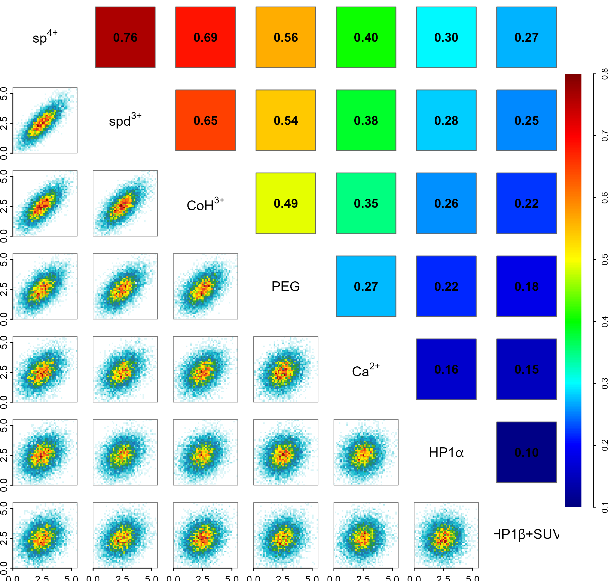
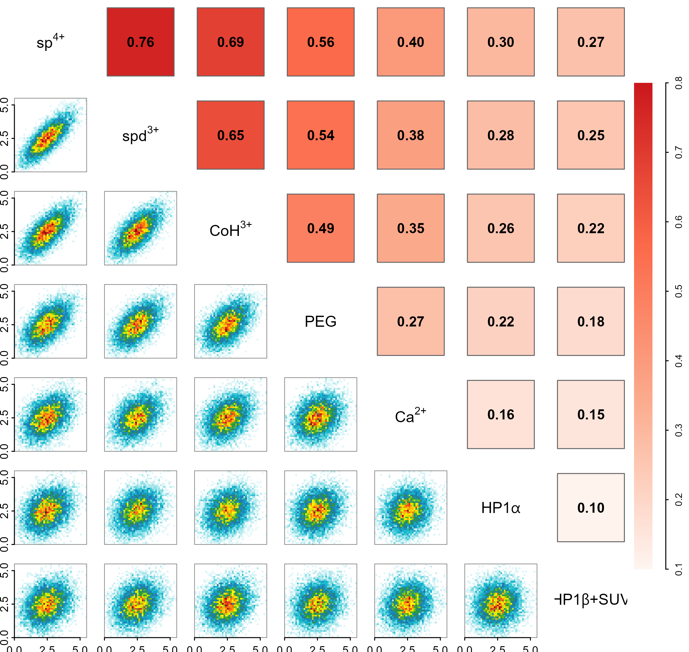

# 密度散点相关矩阵分箱版本

Binned-density correlation matrix

上三角用色块与数值展示Spearman相关，对角写变量名，下三角用二维分箱密度展示观测分布。保留彩虹和红色两套上三角配色，所有相关值由同一示例表计算。

## 科学问题与应用

多个核小体扰动指标的相关强度与二维分布形状是否一致？

- 大规模多变量测量中，用密度避免散点覆盖。
- 比较相似的整体相关值背后是否存在不同分布形状。

## 运行

```text
Rscript --vanilla code/organized.R <output-directory>
```

在已经安装依赖的 R 环境中运行；代码不会安装包、访问网络或运行原研究上游流程。输入从本模块定位，不依赖当前工作目录。输出目录通过第一个参数明确传入；不传入时使用 R 会话临时目录。图形维持模板布局与配色；Arial 字体可用时保持该字体。

依赖：dplyr, ggplot2, patchwork, ragg, tidyr。

## 输入与执行范围

合成示例输入；1个运行期输入表。nucleosome_features.csv：9000行×7列。每个输入的列名和行数见 data_schema.yml。公开版已实际运行，绘图执行范围为合成数据；不是原论文数值或实验结果。

## 独立图像

本模板对应 2 幅独立 PNG，同时生成配对 PDF；它们不合并成一张替代预览。PDF 为运行输出，不随本公共源码分发。

### 11_density_matrix_rainbow.png



### 11_density_matrix_red.png


