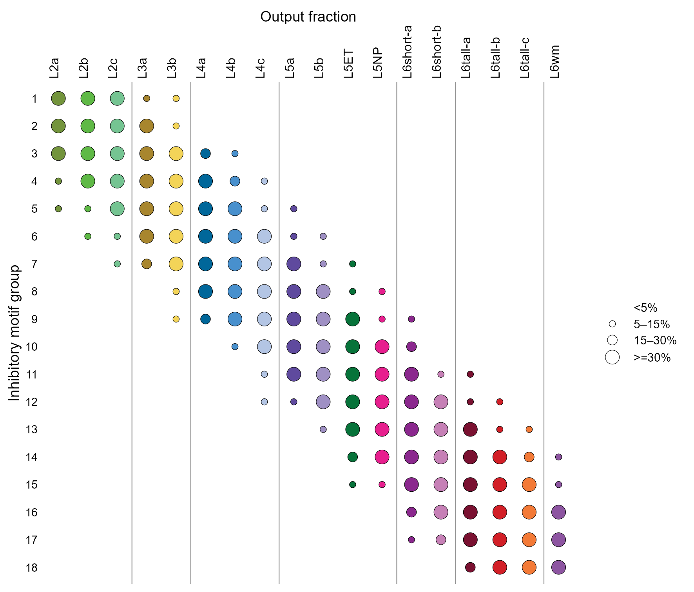
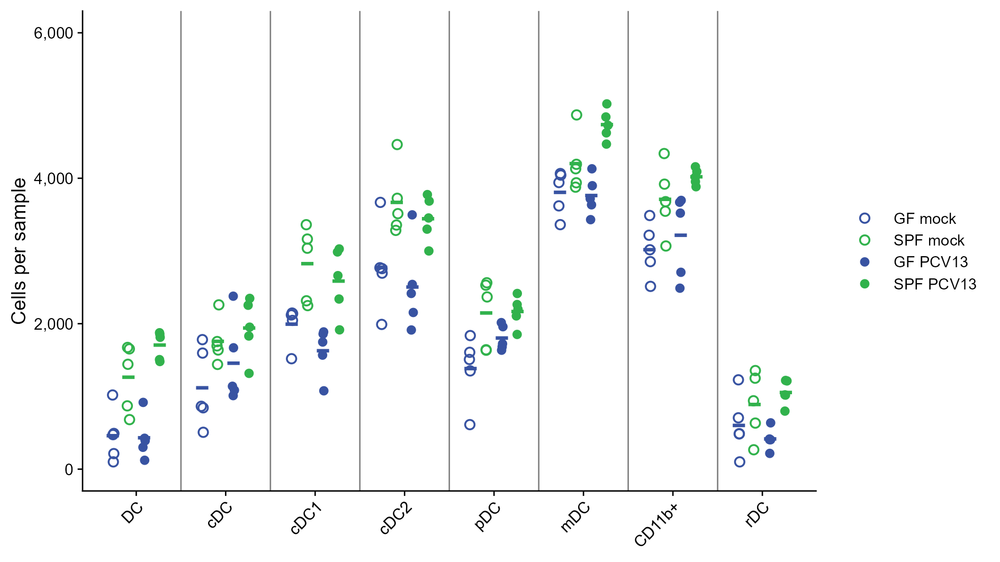

# 突触motif气泡矩阵与分组免疫计数

Synaptic-motif bubble matrix and grouped immune counts

**Synaptic-motif bubble matrix and grouped immune counts**

## 科学问题与应用

类别组成比例和多组细胞数量分别如何清晰对照？

突触比例矩阵的点大小编码；免疫细胞数以蓝绿颜色、空心实心区分条件。

## 运行

```text
Rscript --vanilla code/organized.R <output-directory>
```

在已经安装依赖的 R 环境中运行；代码不会安装包、访问网络或运行原研究上游流程。输入从本模块定位，不依赖当前工作目录。输出目录通过第一个参数明确传入；不传入时使用 R 会话临时目录。图形维持模板布局与配色；Arial 字体可用时保持该字体。

依赖：dplyr, ggplot2, ggrepel, patchwork, ragg, scales, tidyr。

## 输入与执行范围

合成示例输入；2个运行期输入表。motif_matrix.csv：324行×3列；immune_counts.csv：160行×4列。每个输入的列名和行数见 data_schema.yml。公开版已实际运行，绘图执行范围为合成数据；不是原论文数值或实验结果。

## 独立图像

本模板对应 2 幅独立 PNG，同时生成配对 PDF；它们不合并成一张替代预览。PDF 为运行输出，不随本公共源码分发。

### 14a_motif_bubble_matrix.png



### 14b_grouped_immune_counts.png


