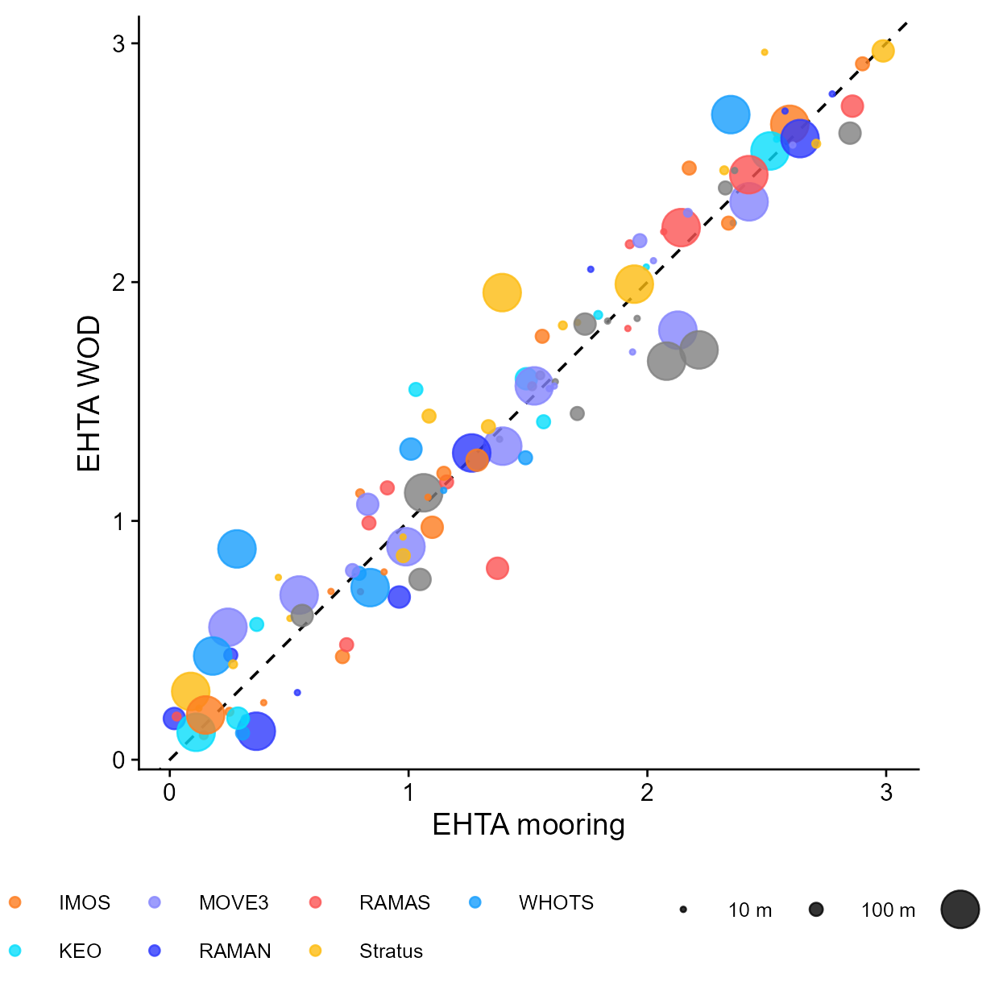
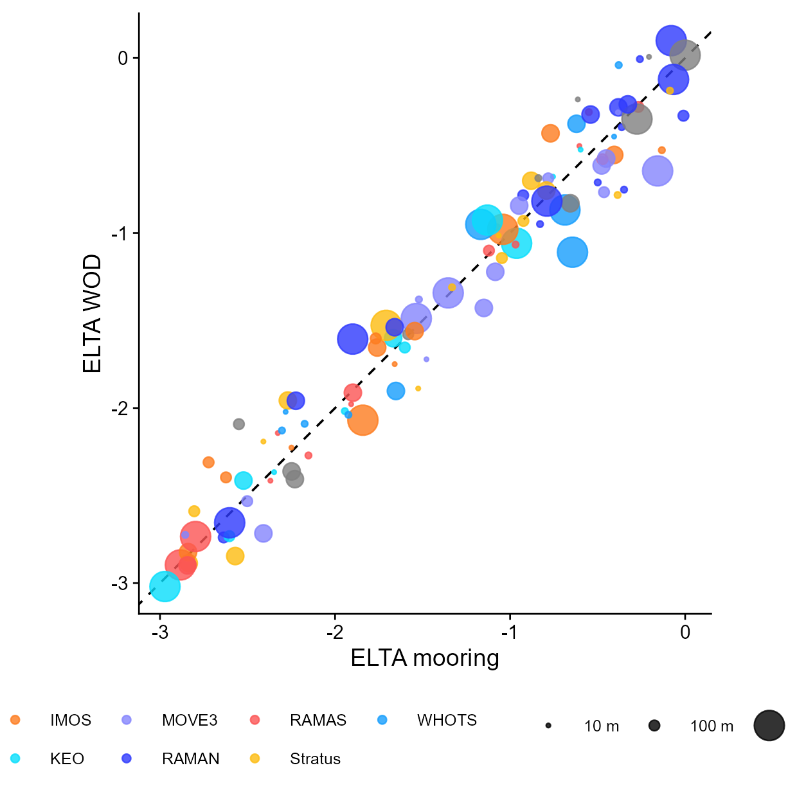
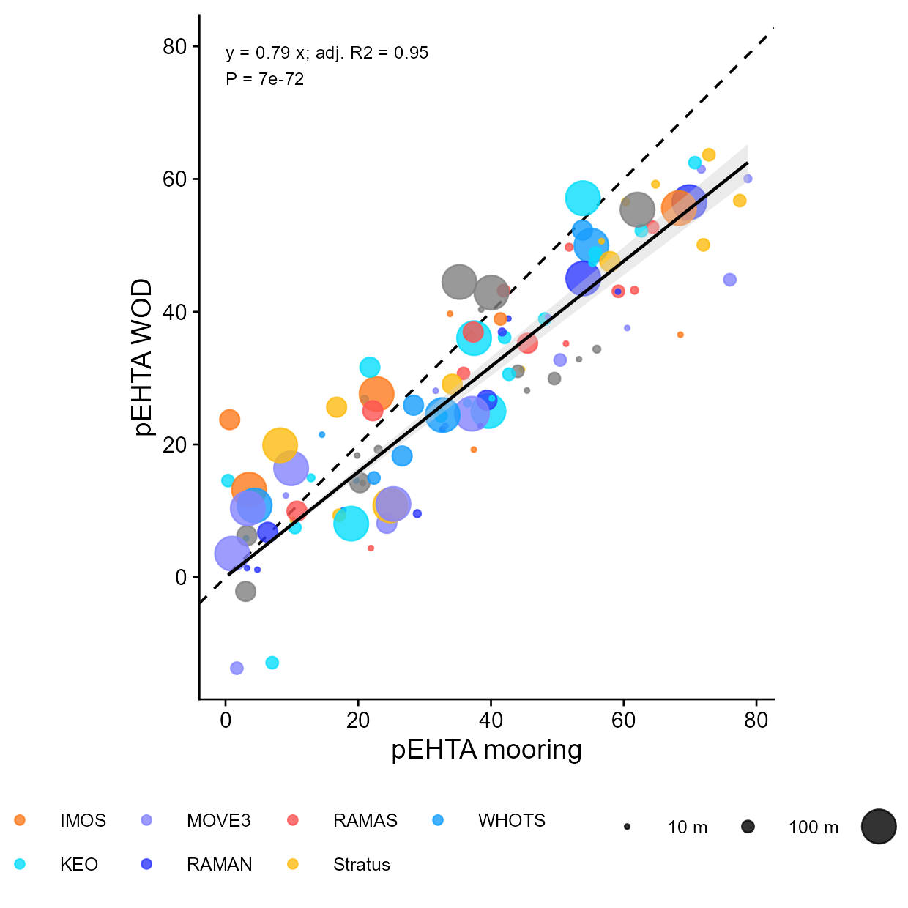
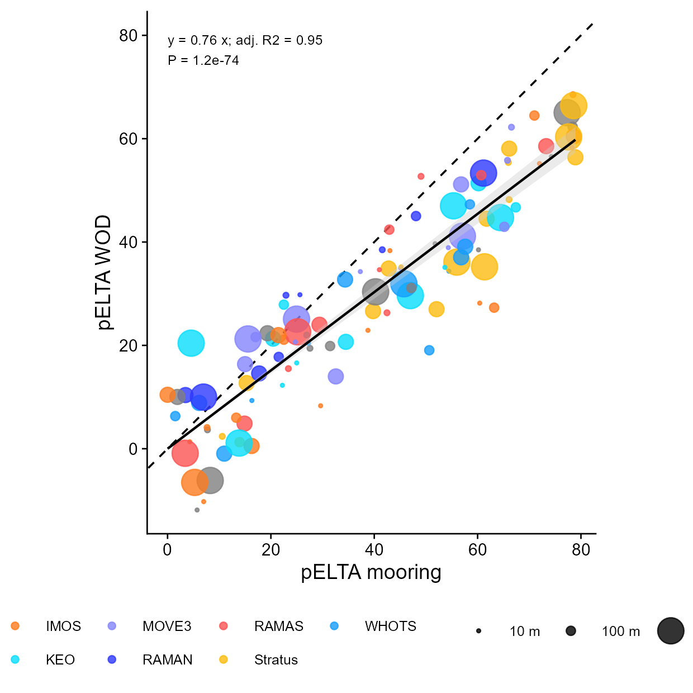
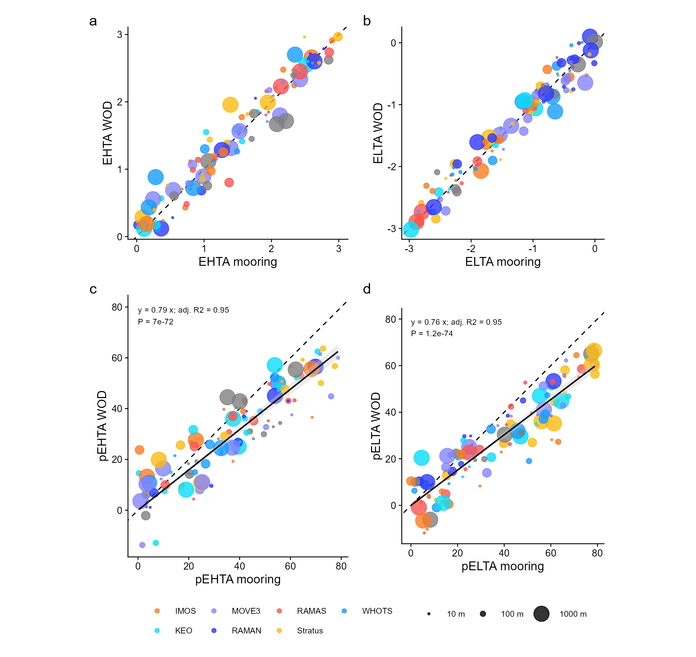
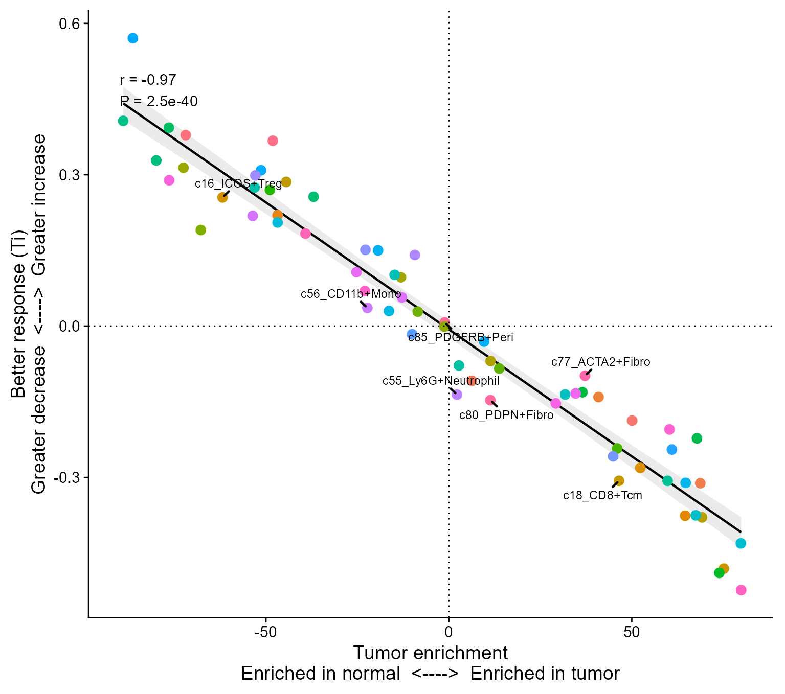
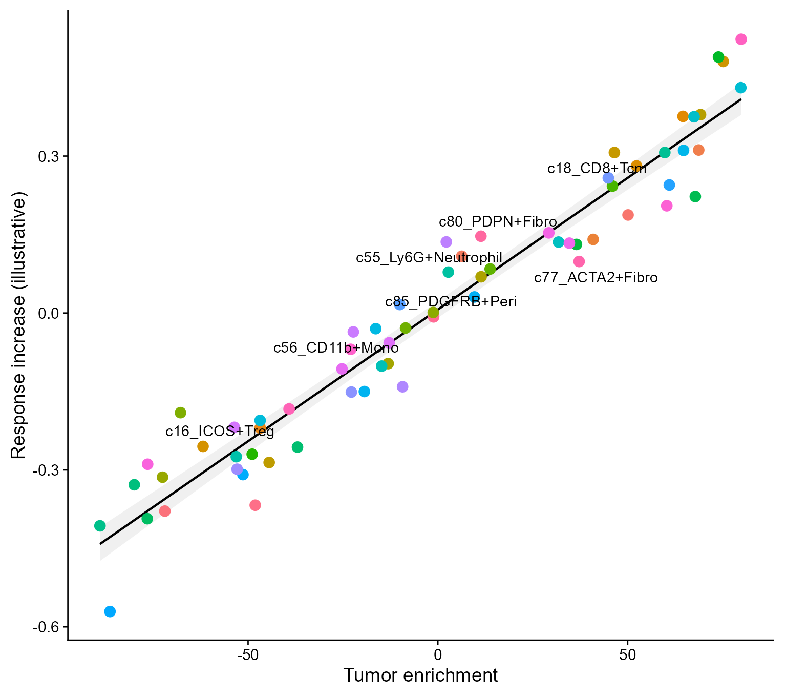

# 气泡回归与肿瘤富集关联散点图

Bubble regressions and tumor-enrichment association scatter

**Bubble regressions and tumor-enrichment association scatter**

## 科学问题与应用

两种测量是否一致，富集程度与疗效指标有何关联？

四面板观测对照、气泡大小编码深度、回归与相关性标注；第二例为细胞群富集和疗效指标。

## 运行

```text
Rscript --vanilla code/organized.R <output-directory>
```

在已经安装依赖的 R 环境中运行；代码不会安装包、访问网络或运行原研究上游流程。输入从本模块定位，不依赖当前工作目录。输出目录通过第一个参数明确传入；不传入时使用 R 会话临时目录。图形维持模板布局与配色；Arial 字体可用时保持该字体。

依赖：dplyr, ggplot2, ggrepel, patchwork, ragg, scales, tidyr。

## 输入与执行范围

合成示例输入；2个运行期输入表。ocean.csv：440行×6列；tumor_response.csv：65行×4列。每个输入的列名和行数见 data_schema.yml。公开版已实际运行，绘图执行范围为合成数据；不是原论文数值或实验结果。

## 独立图像

本模板对应 7 幅独立 PNG，同时生成配对 PDF；它们不合并成一张替代预览。PDF 为运行输出，不随本公共源码分发。

### 07_EHTA.png



### 07_ELTA.png



### 07_pEHTA.png



### 07_pELTA.png



### 07a_ocean_four_panel.png



### 07b_tumor_response.png



### 07c_tumor_response_increase.png


