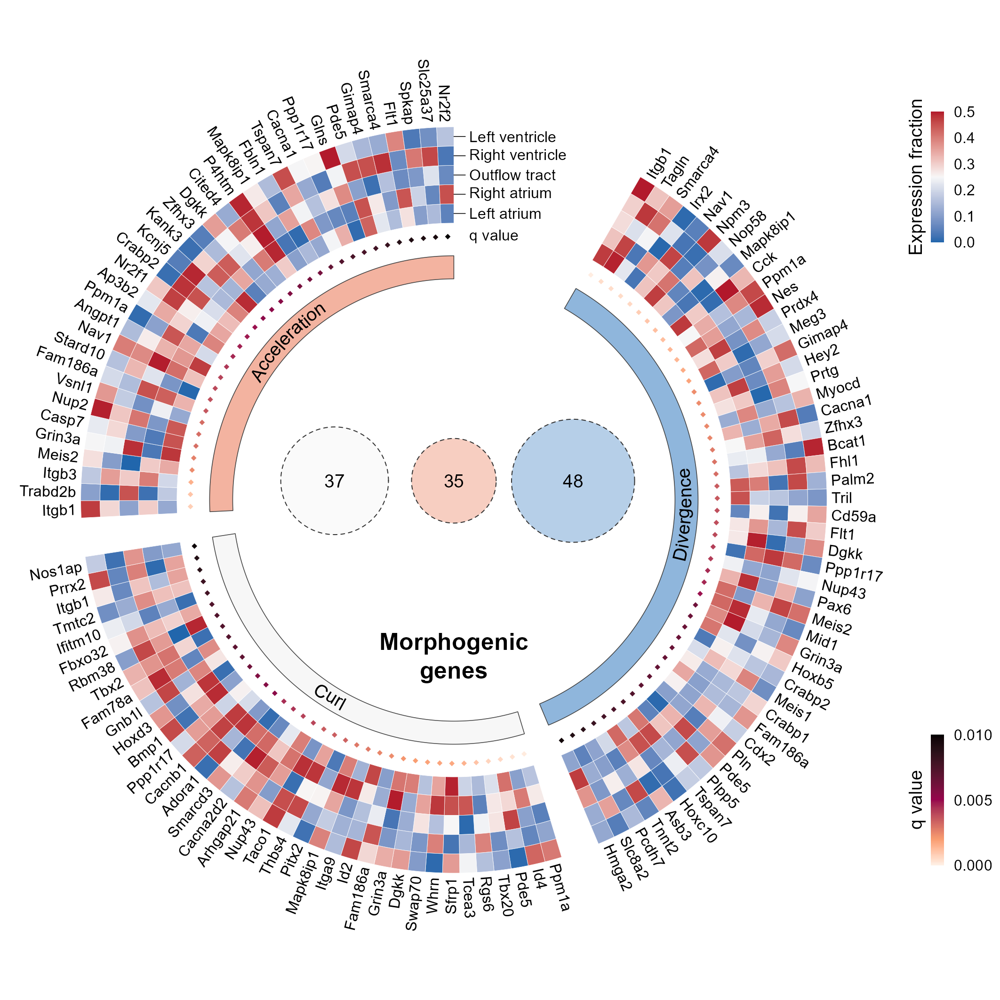
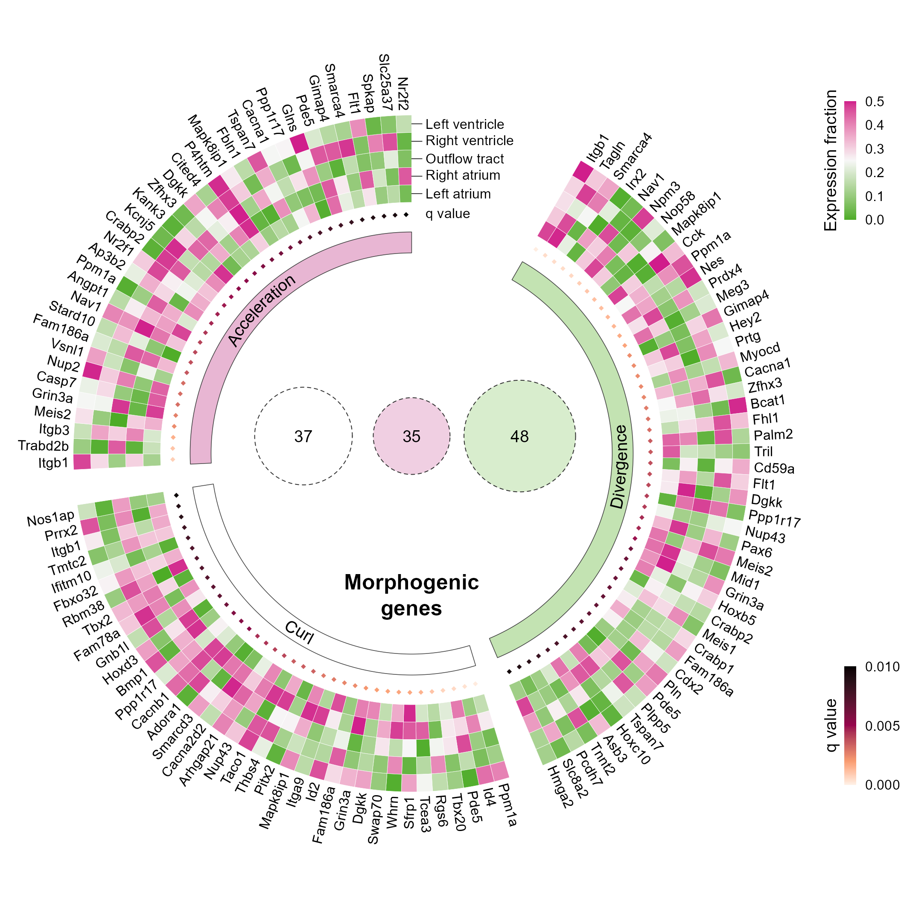

# 形态发生基因环状热图与集合重叠

Circular morphogenic gene heatmap with set overlap

*Circular morphogenic gene heatmap with set overlap*

## 科学问题与应用

三类动力学基因在五个心脏区域的表达与集合重叠如何对应？

空间转录组的区域表达比较；不同分析方法筛选基因的集合交叉。

## 运行

```text
Rscript --vanilla code/organized.R <output-directory>
```

在已经安装依赖的 R 环境中运行；代码不会安装包、访问网络或运行原研究上游流程。输入从本模块定位，不依赖当前工作目录。输出目录通过第一个参数明确传入；不传入时使用 R 会话临时目录。图形维持模板布局与配色；Arial 字体可用时保持该字体。

依赖：circlize, ragg。

## 输入与执行范围

合成示例输入；1个运行期输入表。gene_expression.csv：120行×8列。每个输入的列名和行数见 data_schema.yml。公开版已实际运行，绘图执行范围为合成数据；不是原论文数值或实验结果。

## 独立图像

本模板对应 2 幅独立 PNG，同时生成配对 PDF；它们不合并成一张替代预览。PDF 为运行输出，不随本公共源码分发。

### 04_morphogenic_source_rdbu.png



### 04_morphogenic_tutorial_piyg.png


