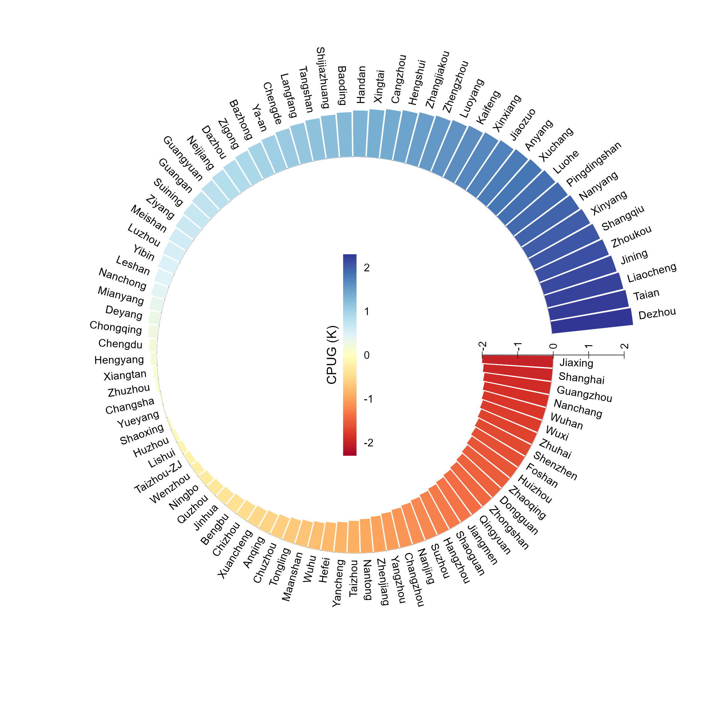
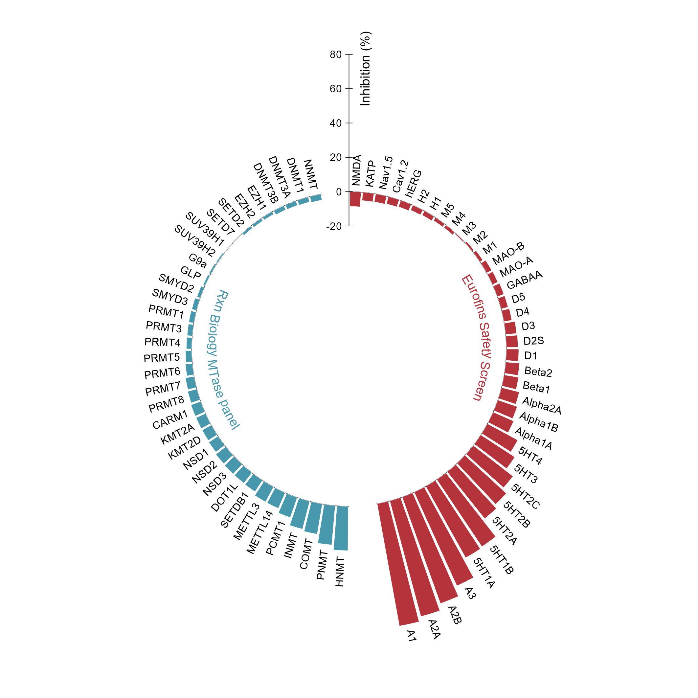

# 分组筛选与连续渐变环形条形图

Grouped screening and continuous circular bar plots

*Grouped screening and continuous circular bar plots*

## 科学问题与应用

分组筛选结果与连续变量排序分别适合怎样的环形编码？

药物靶点筛选面板；带正负值的城市或样本排序。

## 运行

```text
Rscript --vanilla code/organized.R <output-directory>
```

在已经安装依赖的 R 环境中运行；代码不会安装包、访问网络或运行原研究上游流程。输入从本模块定位，不依赖当前工作目录。输出目录通过第一个参数明确传入；不传入时使用 R 会话临时目录。图形维持模板布局与配色；Arial 字体可用时保持该字体。

依赖：RColorBrewer, circlize, ragg。

## 输入与执行范围

合成示例输入；2个运行期输入表。screening.csv：72行×3列；city_indicator.csv：92行×2列。每个输入的列名和行数见 data_schema.yml。公开版已实际运行，绘图执行范围为合成数据；不是原论文数值或实验结果。

## 独立图像

本模板对应 2 幅独立 PNG，同时生成配对 PDF；它们不合并成一张替代预览。PDF 为运行输出，不随本公共源码分发。

### 09_continuous_city_bars.png



### 09_grouped_screening_inhibition.png


