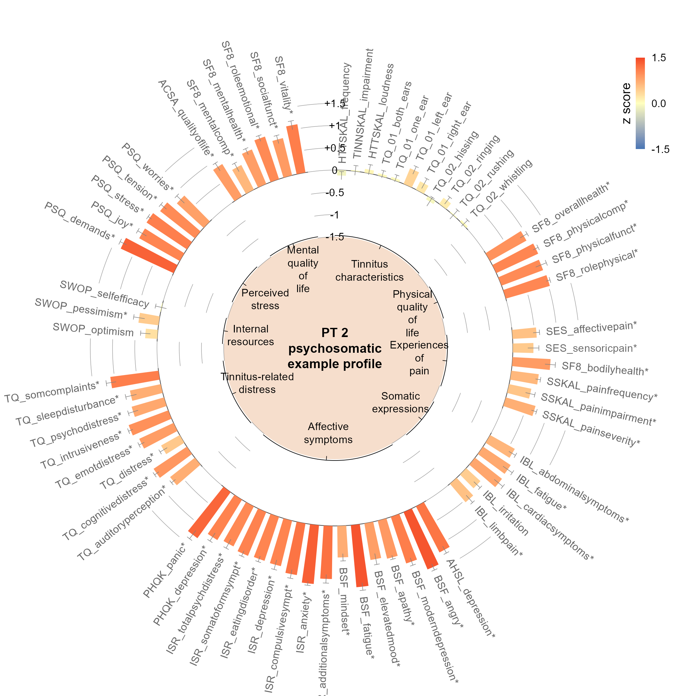
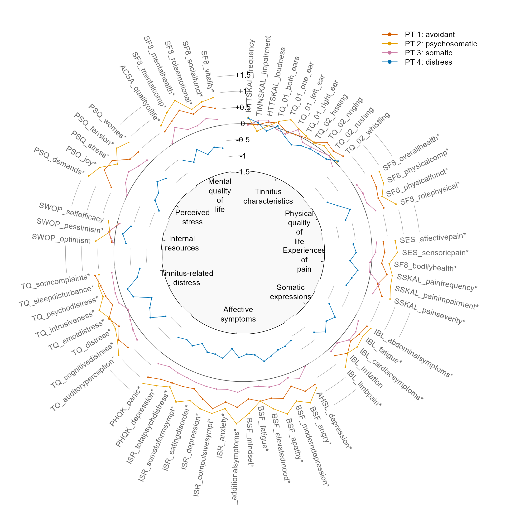

# 表型九类指标渐变柱与分组折线

Phenotype profiles with gradient bars and grouped lines

*Phenotype profiles with gradient bars and grouped lines*

## 科学问题与应用

不同表型在九类标准化特征上的偏离模式是否一致？

问卷表型分析；临床亚群的标准化多指标比较。

## 运行

```text
Rscript --vanilla code/organized.R <output-directory>
```

在已经安装依赖的 R 环境中运行；代码不会安装包、访问网络或运行原研究上游流程。输入从本模块定位，不依赖当前工作目录。输出目录通过第一个参数明确传入；不传入时使用 R 会话临时目录。图形维持模板布局与配色；Arial 字体可用时保持该字体。

依赖：circlize, ragg。

## 输入与执行范围

合成示例输入；2个运行期输入表。phenotype_bars.csv：64行×5列；phenotype_lines.csv：256行×5列。每个输入的列名和行数见 data_schema.yml。公开版已实际运行，绘图执行范围为合成数据；不是原论文数值或实验结果。

## 独立图像

本模板对应 2 幅独立 PNG，同时生成配对 PDF；它们不合并成一张替代预览。PDF 为运行输出，不随本公共源码分发。

### 08_tinnitus_gradient_bars.png



### 08_tinnitus_grouped_lines.png


