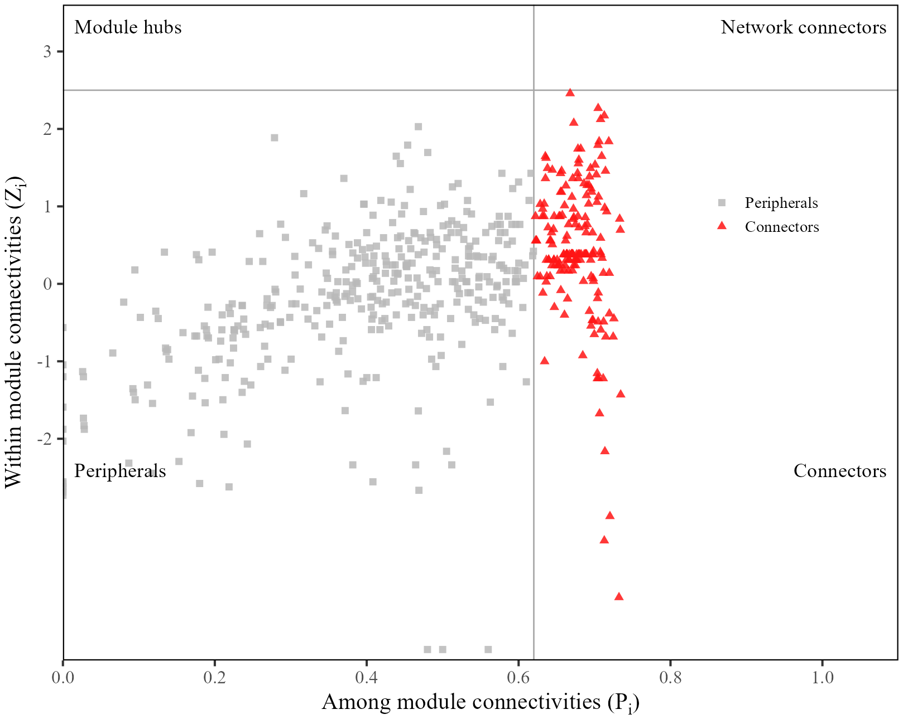
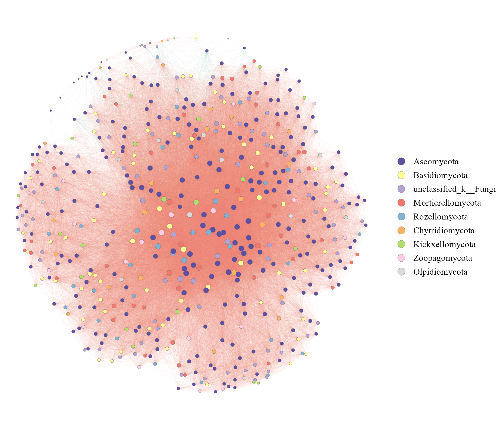
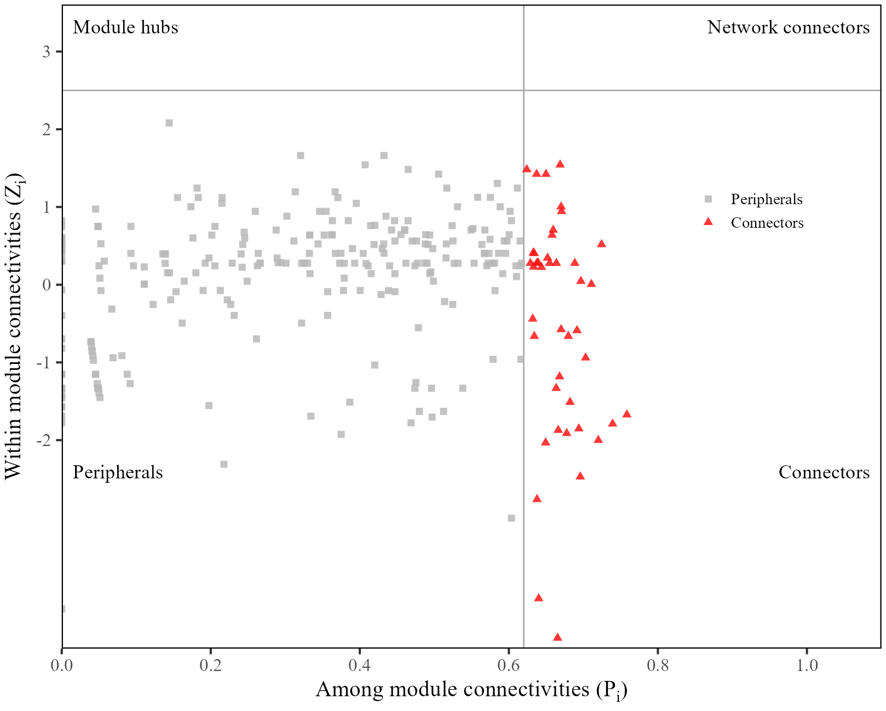
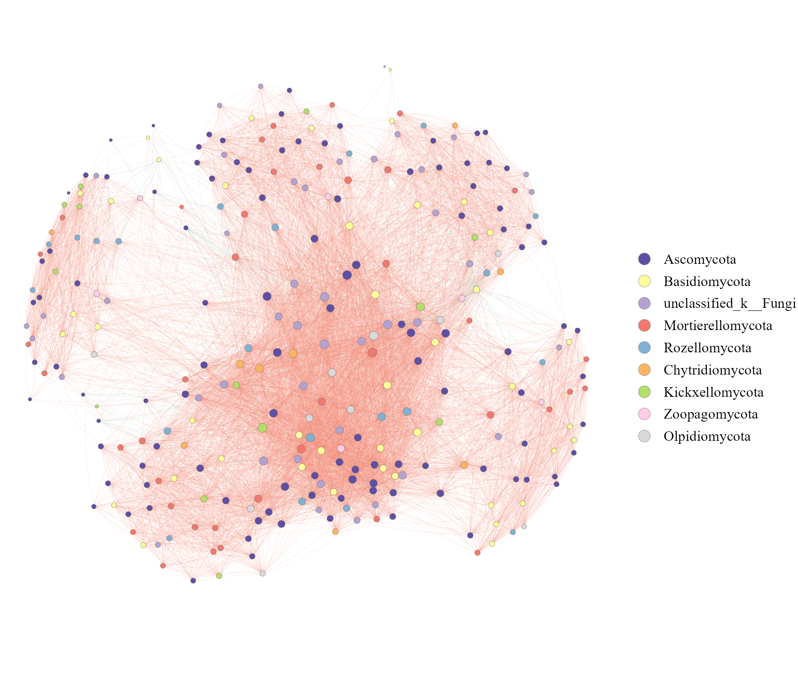
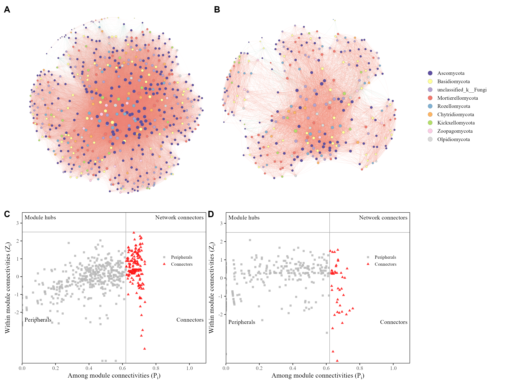

# 微生物共现网络与Zi-Pi角色

Co-occurrence networks and Zi-Pi roles

两组合成OTU计数分别经过相对丰度与出现频率过滤、Spearman相关筛边、Fast Greedy模块划分，网络按门着色并区分相关正负；下方用Pi=0.62和Zi=2.5显示拓扑角色。保留GraphML、节点角色和网络指标。

## 科学问题与应用

OTU相关网络中哪些节点跨模块连接较多，哪些节点模块内连接较强？

- 基于明确阈值审阅微生物共现图及节点拓扑角色。
- 将网络计算结果导出到Gephi继续布局，而不把正负相关解释为已证实的协作或竞争。

## 运行

```text
Rscript --vanilla code/organized.R <output-directory>
```

在已经安装依赖的 R 环境中运行；代码不会安装包、访问网络或运行原研究上游流程。输入从本模块定位，不依赖当前工作目录。输出目录通过第一个参数明确传入；不传入时使用 R 会话临时目录。图形维持模板布局与配色；Arial 字体可用时保持该字体。

依赖：Hmisc, cowplot, dplyr, ggnewscale, ggplot2, igraph, patchwork, ragg, tidyr。

## 输入与执行范围

合成示例输入；3个运行期输入表。otu_counts_G.csv：225行×33列；otu_counts_T.csv：175行×29列。每个输入的列名和行数见 data_schema.yml。公开版已实际运行，绘图执行范围为合成数据；不是原论文数值或实验结果。

## 独立图像

本模板对应 5 幅独立 PNG，同时生成配对 PDF；它们不合并成一张替代预览。PDF 为运行输出，不随本公共源码分发。

### 13_G_ZiPi_roles.png



### 13_G_cooccurrence_network.png



### 13_T_ZiPi_roles.png



### 13_T_cooccurrence_network.png



### 13_networks_and_ZiPi.png


