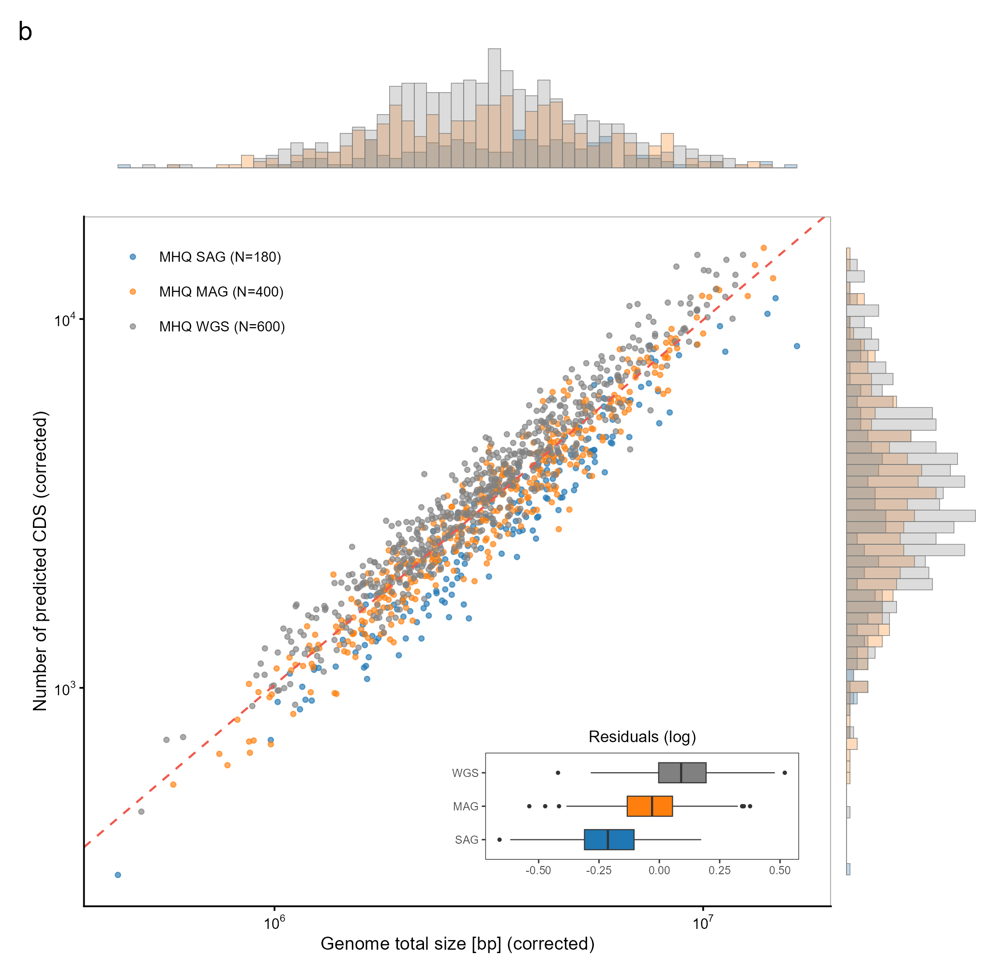
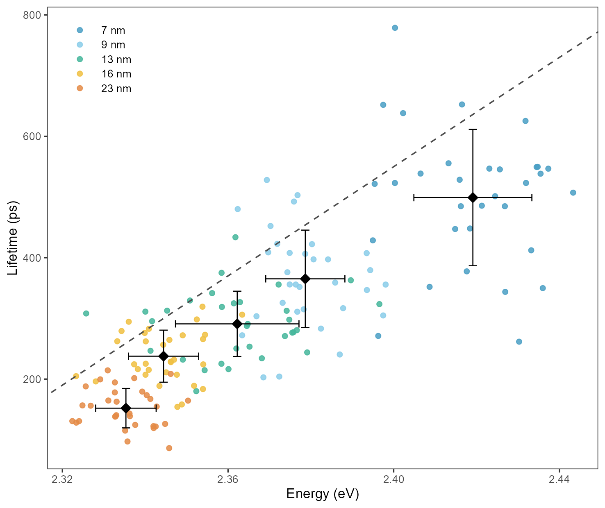
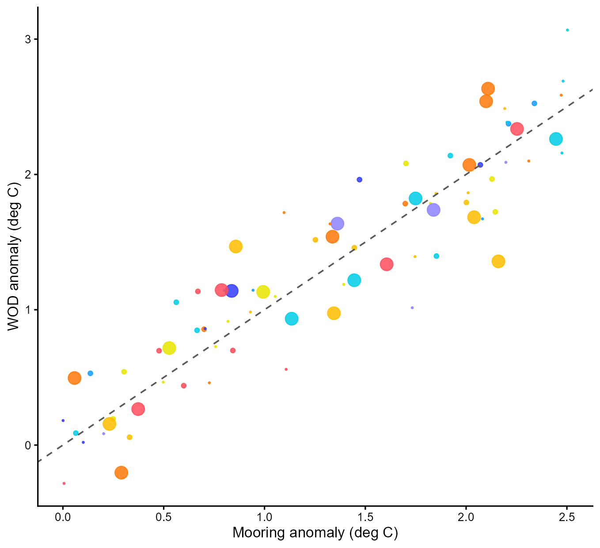
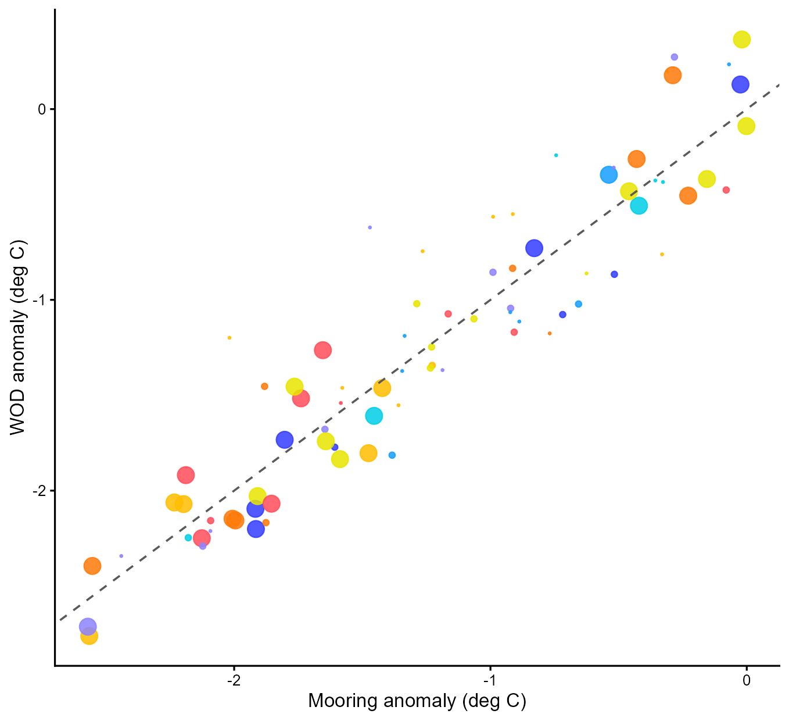
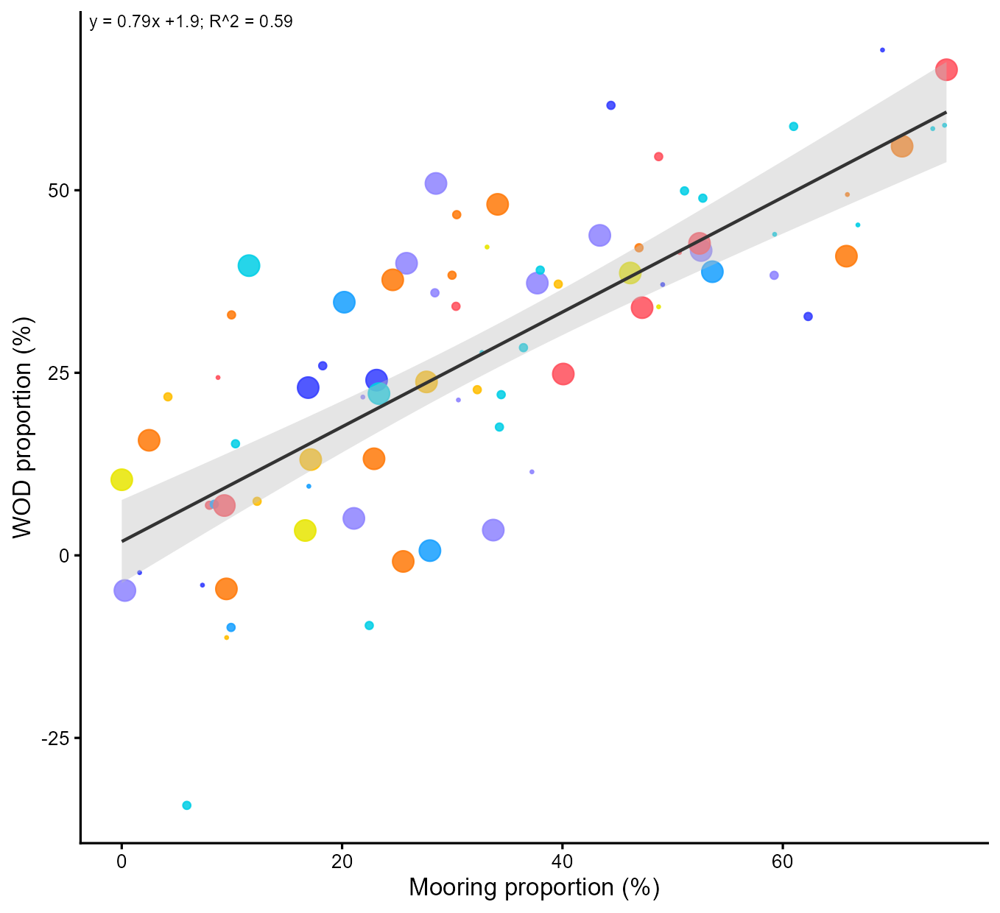
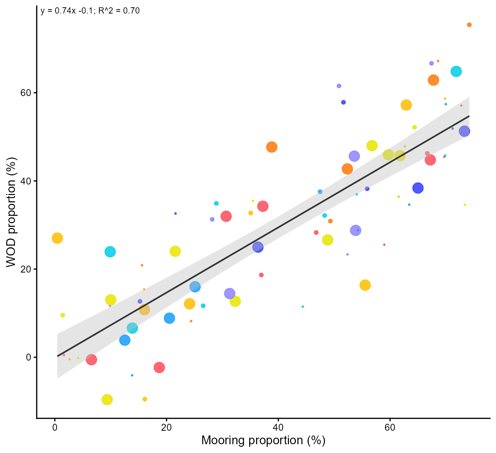
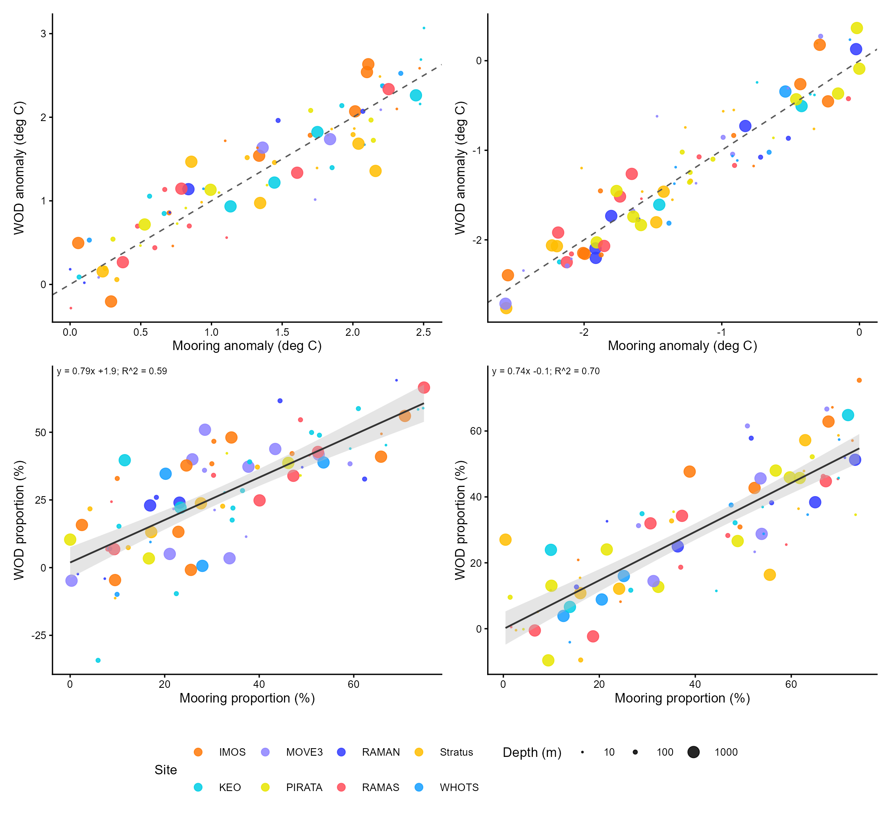
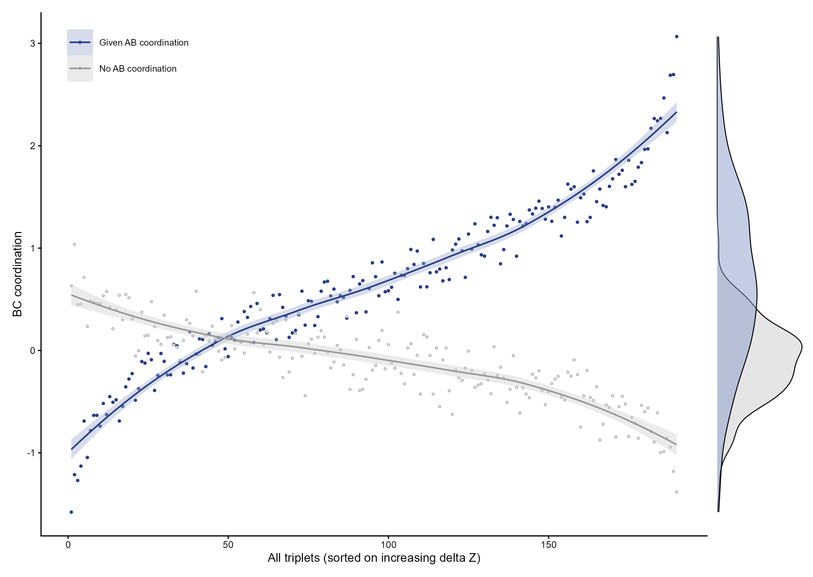
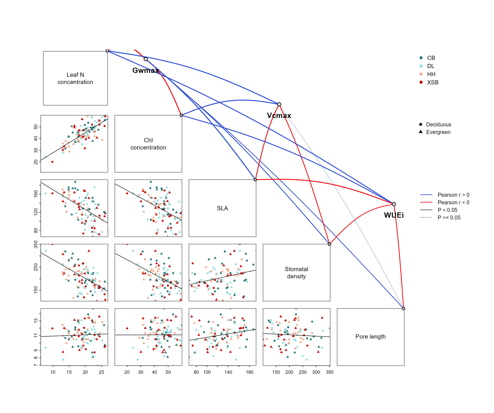
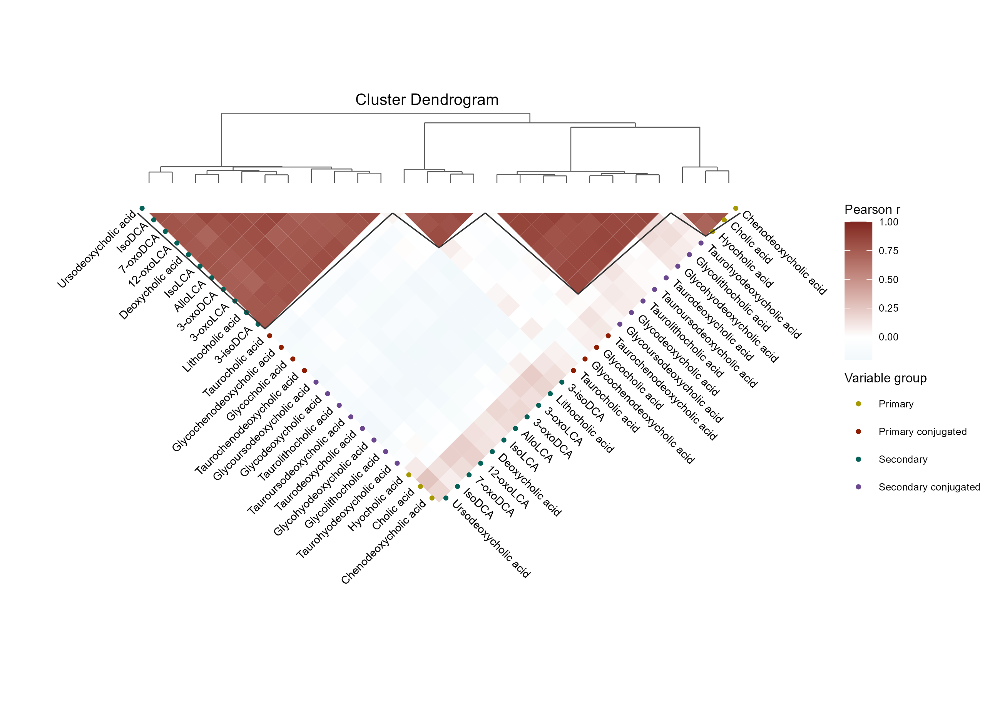

# 十种相关性图复刻案例总览

Correlation case-study collection

原文是案例汇总，不是一个独立的第八类图。保留其11个可见图片块：8块映射到本批已重画的相同主题，另外补齐能量—寿命分组散点、四面板配对海洋指标、配对协调图与边缘密度。

## 科学问题与应用

不同变量维度与数据结构应选用何种相关性表达？

- 对照散点、矩阵、聚类、气泡和Mantel网络选择合适模板。
- 作为模板审阅入口，比较同一统计目标在不同维度下的展示方式。

## 运行

```text
Rscript --vanilla code/organized.R <output-directory>
```

在已经安装依赖的 R 环境中运行；代码不会安装包、访问网络或运行原研究上游流程。输入从本模块定位，不依赖当前工作目录。输出目录通过第一个参数明确传入；不传入时使用 R 会话临时目录。图形维持模板布局与配色；Arial 字体可用时保持该字体。

依赖：circlize, cowplot, dplyr, ggdendro, ggplot2, linkET, patchwork, pheatmap, ragg, scales, tidyr。

## 输入与执行范围

合成示例输入；16个运行期输入表。rice_traits.csv：170行×5列；environment_variables.csv：75行×37列。每个输入的列名和行数见 data_schema.yml。公开版已实际运行，绘图执行范围为合成数据；不是原论文数值或实验结果。

## 独立图像

本模板对应 18 幅独立 PNG，同时生成配对 PDF；它们不合并成一张替代预览。PDF 为运行输出，不随本公共源码分发。

### 08_case01_complete.png



### 08_case02_complete.png



### 08_case02_energy_lifetime.png


### 08_case03_complete.png


### 08_case03_ocean_panel1.png



### 08_case03_ocean_panel2.png



### 08_case03_ocean_panel3.png



### 08_case03_ocean_panel4.png



### 08_case03_paired_ocean.png



### 08_case04_complete.png



### 08_case04_paired_coordination.png


### 08_case05_complete.png


### 08_case06_complete.png



### 08_case07_complete.png


### 08_case08_complete.png



### 08_case09_complete.png


### 08_case10_complete.png


### 08_case11_complete.png


