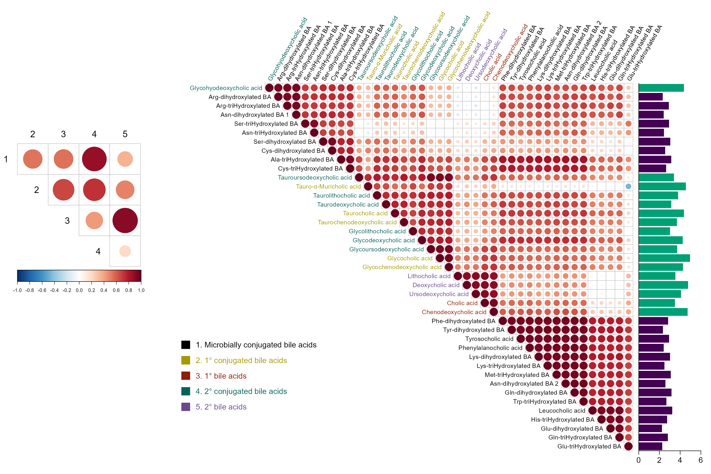

# 胆汁酸相关矩阵与边缘浓度条形图

Bile acid correlations and marginal bars

用上三角气泡矩阵表现胆汁酸的两两Pearson相关，颜色与点大小共同表达相关方向和强度；斜向变量名按胆汁酸类别着色，右侧浓度条形与矩阵行严格对齐，左侧小图显示五类总量之间的相关。

## 科学问题与应用

胆汁酸之间是否呈现分组相关，变量平均丰度是否与相关模式一致？

- 检查代谢组中同类及跨类别代谢物的共变模式。
- 同时查看高丰度代谢物与相关模块，避免只从相关强度猜测浓度。

## 运行

```text
Rscript --vanilla code/organized.R <output-directory>
```

在已经安装依赖的 R 环境中运行；代码不会安装包、访问网络或运行原研究上游流程。输入从本模块定位，不依赖当前工作目录。输出目录通过第一个参数明确传入；不传入时使用 R 会话临时目录。图形维持模板布局与配色；Arial 字体可用时保持该字体。

依赖：dplyr, ggplot2, patchwork, ragg, tidyr。

## 输入与执行范围

合成示例输入；1个运行期输入表。bile_acid_abundance.csv：90行×37列。每个输入的列名和行数见 data_schema.yml。公开版已实际运行，绘图执行范围为合成数据；不是原论文数值或实验结果。

## 独立图像

本模板对应 1 幅独立 PNG，同时生成配对 PDF；它们不合并成一张替代预览。PDF 为运行输出，不随本公共源码分发。

### 03_bile_acid_matrix_marginals.png


