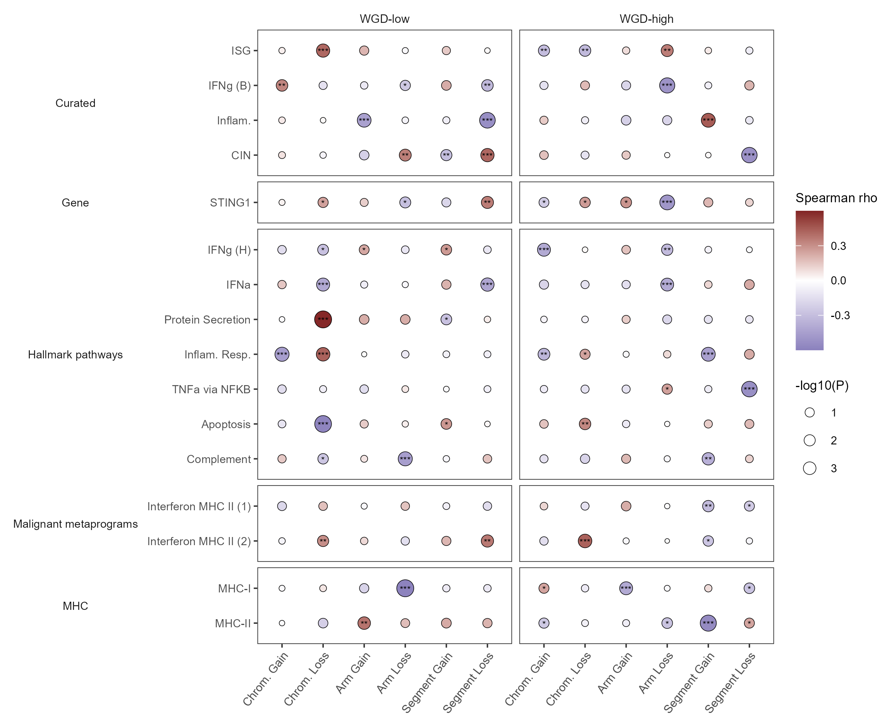
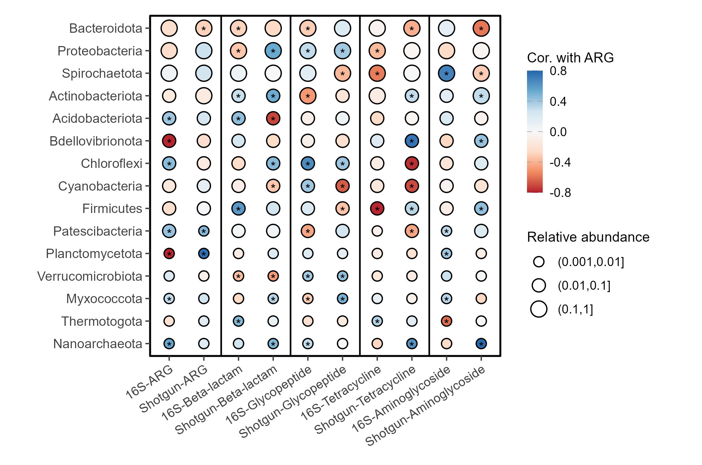

# 显著性与丰度双编码相关点阵

Correlation dotplots: P value and abundance

第一幅按WGD组和通路类别分面，颜色编码Spearman rho、点大小编码-log10P、星号标记显著性；第二幅对细菌门与ARG指标作点阵，颜色编码相关、大小改为相对丰度分档。

## 科学问题与应用

多组特征间的关联方向、统计显著性和丰度如何分别表达？

- 比较单细胞转录与基因组改变之间的多层级关联。
- 比较微生物类群与抗性基因指标时，明确区分丰度大小和P值大小两种语义。

## 运行

```text
Rscript --vanilla code/organized.R <output-directory>
```

在已经安装依赖的 R 环境中运行；代码不会安装包、访问网络或运行原研究上游流程。输入从本模块定位，不依赖当前工作目录。输出目录通过第一个参数明确传入；不传入时使用 R 会话临时目录。图形维持模板布局与配色；Arial 字体可用时保持该字体。

依赖：dplyr, ggplot2, patchwork, ragg, tidyr。

## 输入与执行范围

合成示例输入；2个运行期输入表。wgd_correlations.csv：192行×6列；arg_correlations.csv：150行×5列。每个输入的列名和行数见 data_schema.yml。公开版已实际运行，绘图执行范围为合成数据；不是原论文数值或实验结果。

## 独立图像

本模板对应 2 幅独立 PNG，同时生成配对 PDF；它们不合并成一张替代预览。PDF 为运行输出，不随本公共源码分发。

### 09a_wgd_significance_dotplot.png



### 09b_arg_abundance_dotplot.png


