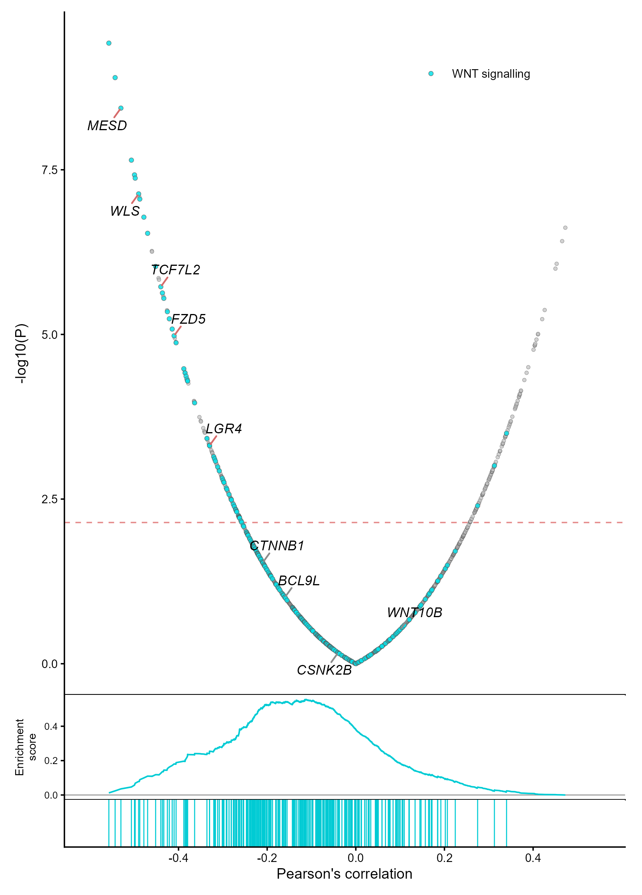
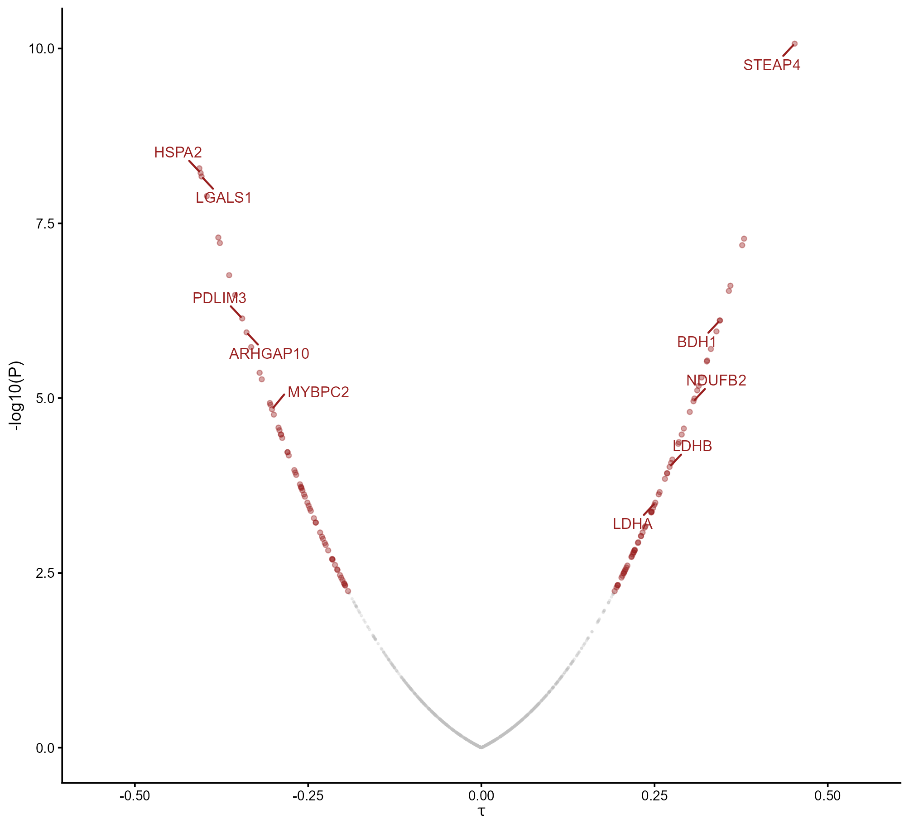

# 相关性火山图与运行富集曲线

Correlation volcanoes and enrichment

Pearson火山图中灰点为背景、青色点高亮WNT成员，FDR阈值虚线与基因标签由输入表映射；下面的运行富集曲线和rug沿同一相关轴对齐。另绘Kendall tau火山图，显著蛋白以暗红突出。

## 科学问题与应用

哪些基因或蛋白与连续表型相关，一组通路成员是否集中在相关排序的一端？

- 在已有逐基因或逐蛋白相关统计表上高亮关注集合。
- 同时审阅相关方向、显著性与排序富集位置；富集曲线本身不是机制或显著GSEA的证明。

## 运行

```text
Rscript --vanilla code/organized.R <output-directory>
```

在已经安装依赖的 R 环境中运行；代码不会安装包、访问网络或运行原研究上游流程。输入从本模块定位，不依赖当前工作目录。输出目录通过第一个参数明确传入；不传入时使用 R 会话临时目录。图形维持模板布局与配色；Arial 字体可用时保持该字体。

依赖：dplyr, ggplot2, ggrepel, patchwork, ragg, tidyr。

## 输入与执行范围

合成示例输入；2个运行期输入表。wnt_correlations.csv：1800行×6列；kendall_correlations.csv：1100行×5列。每个输入的列名和行数见 data_schema.yml。公开版已实际运行，绘图执行范围为合成数据；不是原论文数值或实验结果。

## 独立图像

本模板对应 2 幅独立 PNG，同时生成配对 PDF；它们不合并成一张替代预览。PDF 为运行输出，不随本公共源码分发。

### 14a_pearson_wnt_enrichment.png



### 14b_kendall_tau_volcano.png


