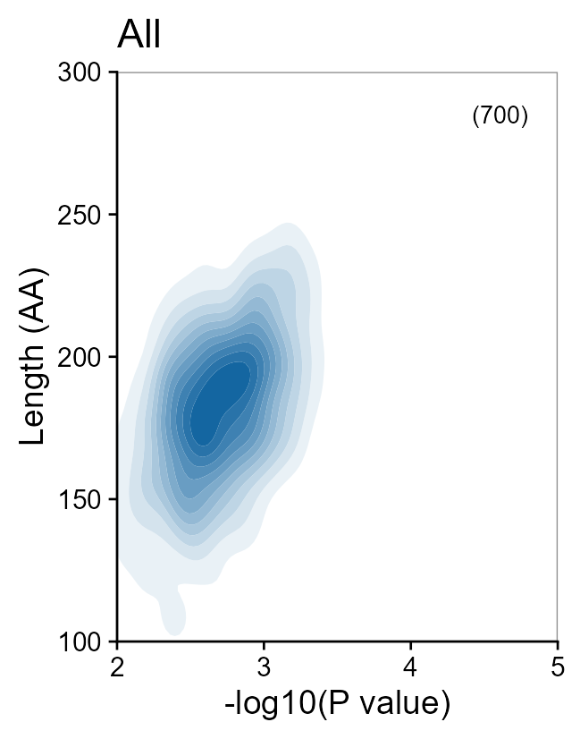
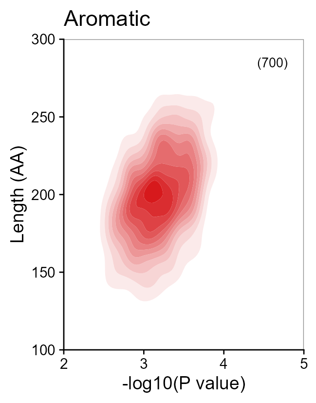
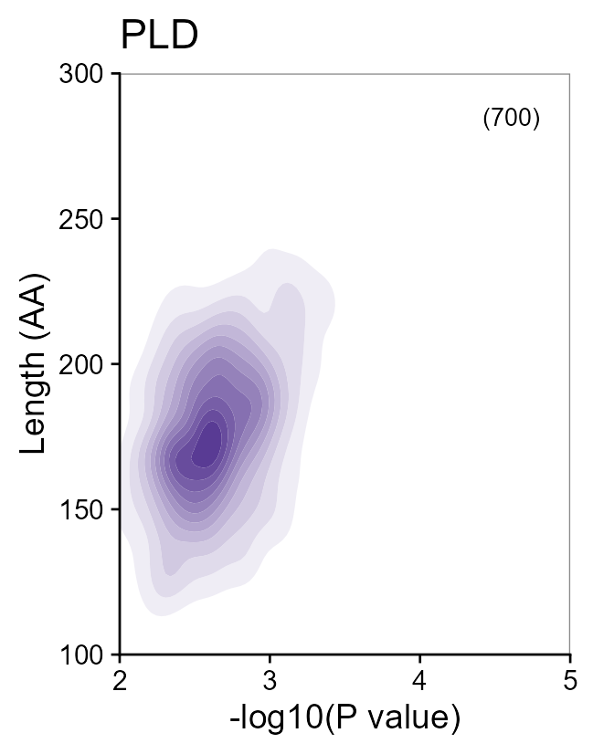
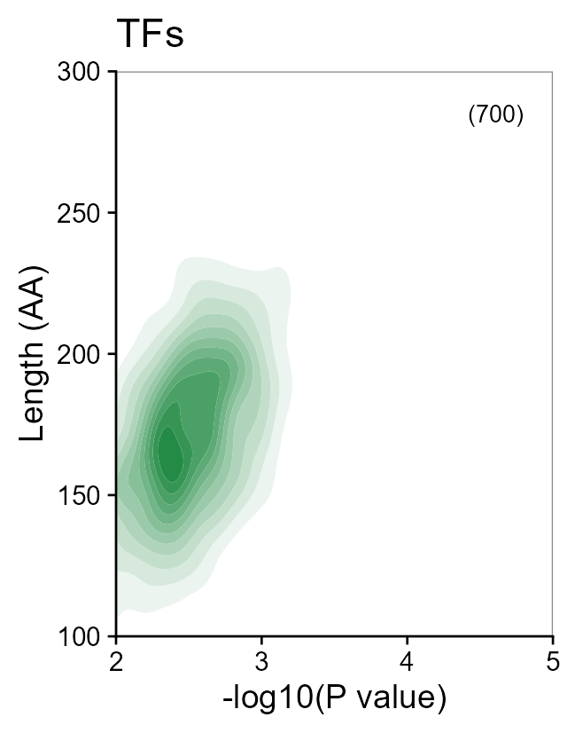
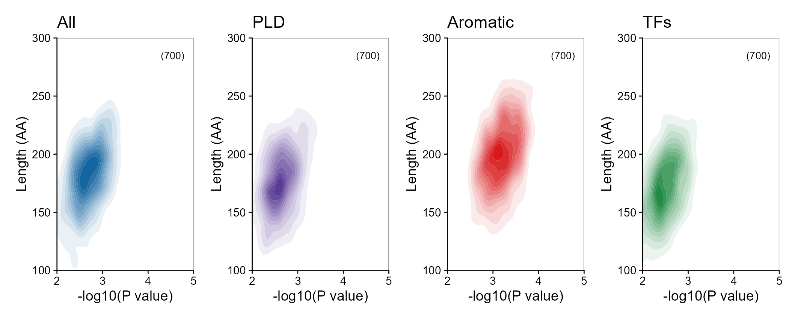
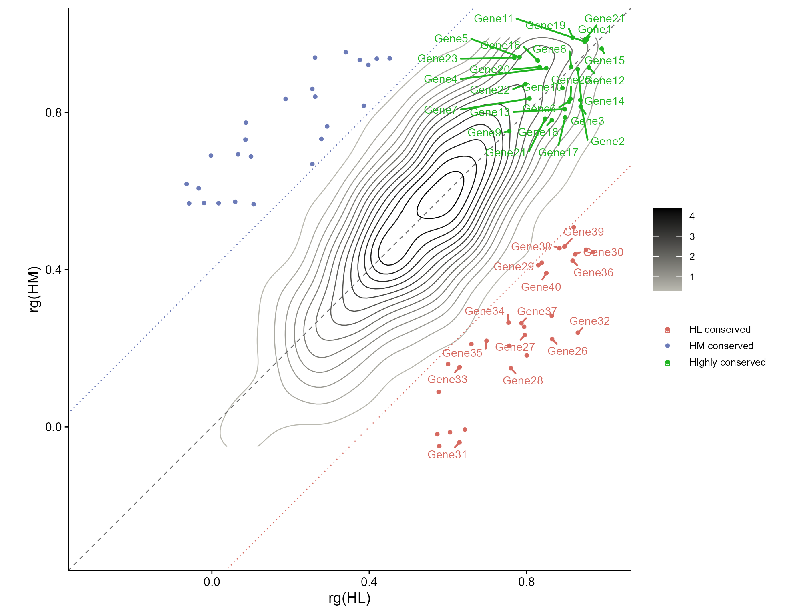

# 填充密度等高线与跨物种保守性

Filled density contours and cross-species conservation

**Filled density contours and cross-species conservation**

## 科学问题与应用

二维变量的密集区域在哪里，不同保守性类别偏离对角线多少？

四种区域二维密度对照；跨物种相关系数等高线、阈值线与重点基因标签。

## 运行

```text
Rscript --vanilla code/organized.R <output-directory>
```

在已经安装依赖的 R 环境中运行；代码不会安装包、访问网络或运行原研究上游流程。输入从本模块定位，不依赖当前工作目录。输出目录通过第一个参数明确传入；不传入时使用 R 会话临时目录。图形维持模板布局与配色；Arial 字体可用时保持该字体。

依赖：dplyr, ggnewscale, ggplot2, ggrepel, patchwork, ragg, tidyr。

## 输入与执行范围

合成示例输入；2个运行期输入表。periodicity.csv：2800行×4列；conservation.csv：2100行×5列。每个输入的列名和行数见 data_schema.yml。公开版已实际运行，绘图执行范围为合成数据；不是原论文数值或实验结果。

## 独立图像

本模板对应 6 幅独立 PNG，同时生成配对 PDF；它们不合并成一张替代预览。PDF 为运行输出，不随本公共源码分发。

### 13_All.png



### 13_Aromatic.png



### 13_PLD.png



### 13_TFs.png



### 13a_periodicity_contours.png



### 13b_conservation_contours.png


