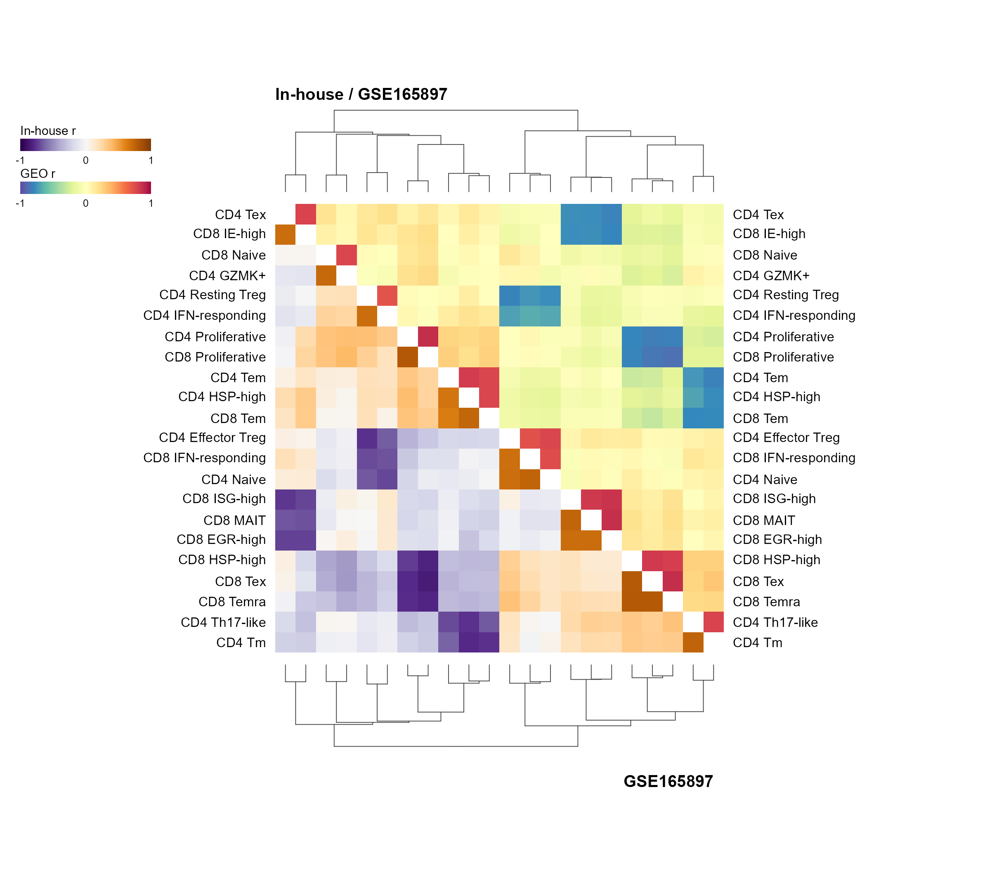

# 双队列三角相关性聚类热图

Dual-cohort triangular clustermap

在同一正方形中用两套调色板区分队列：上三角显示GEO示例，下三角显示in-house示例，对角线留白，顶部和底部绘制与共同排序严格对应的聚类树。

## 科学问题与应用

两个队列中细胞状态之间的相关结构是否一致？

- 比较发现队列和验证队列的状态相关结构。
- 检查相同细胞类型标签在不同样本集合中是否形成类似模块。

## 运行

```text
Rscript --vanilla code/organized.R <output-directory>
```

在已经安装依赖的 R 环境中运行；代码不会安装包、访问网络或运行原研究上游流程。输入从本模块定位，不依赖当前工作目录。输出目录通过第一个参数明确传入；不传入时使用 R 会话临时目录。图形维持模板布局与配色；Arial 字体可用时保持该字体。

依赖：RColorBrewer, circlize, dplyr, ggdendro, ggplot2, patchwork, ragg, tidyr。

## 输入与执行范围

合成示例输入；2个运行期输入表。cohort_GEO.csv：80行×23列；cohort_inhouse.csv：80行×23列。每个输入的列名和行数见 data_schema.yml。公开版已实际运行，绘图执行范围为合成数据；不是原论文数值或实验结果。

## 独立图像

本模板对应 1 幅独立 PNG，同时生成配对 PDF；它们不合并成一张替代预览。PDF 为运行输出，不随本公共源码分发。

### 04_dual_cohort_triangle_clustermap.png


