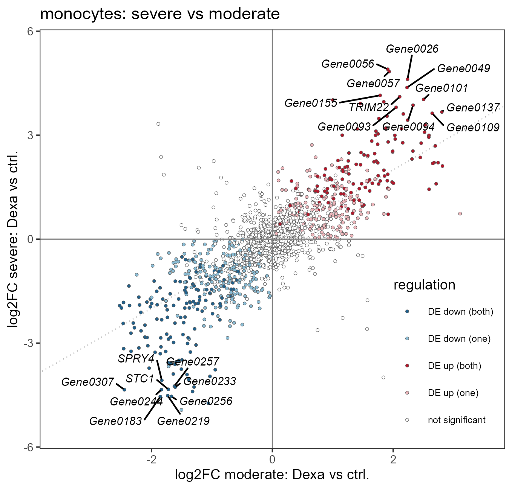
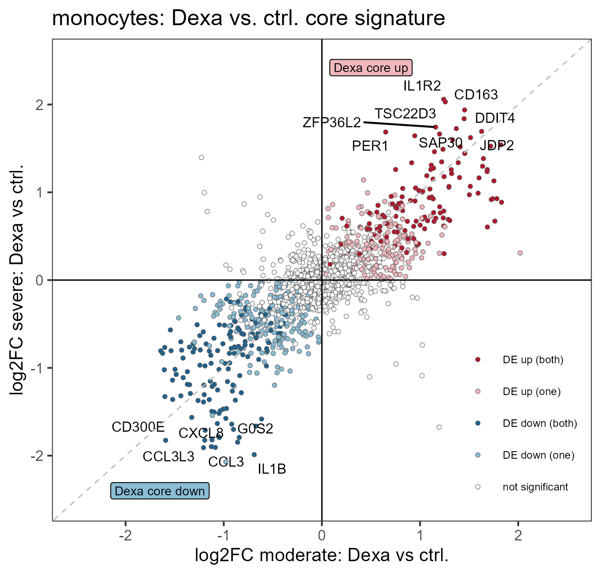

# Cell式双比较显著性散点图

Cell-style dual-comparison significance scatter

**Cell-style dual-comparison significance scatter**

## 科学问题与应用

两种比较中共同显著与仅单独显著的基因分布有何不同？

同向/异向差异比较，以及联合显著性类别展示。

## 运行

```text
Rscript --vanilla code/organized.R <output-directory>
```

在已经安装依赖的 R 环境中运行；代码不会安装包、访问网络或运行原研究上游流程。输入从本模块定位，不依赖当前工作目录。输出目录通过第一个参数明确传入；不传入时使用 R 会话临时目录。图形维持模板布局与配色；Arial 字体可用时保持该字体。

依赖：dplyr, ggplot2, ggrepel, patchwork, ragg, tidyr。

## 输入与执行范围

合成示例输入；1个运行期输入表。fold_changes.csv：1600行×5列。每个输入的列名和行数见 data_schema.yml。公开版已实际运行，绘图执行范围为合成数据；不是原论文数值或实验结果。

## 独立图像

本模板对应 2 幅独立 PNG，同时生成配对 PDF；它们不合并成一张替代预览。PDF 为运行输出，不随本公共源码分发。

### 03_cell_fc_fc.png



### 03_core_signature.png


