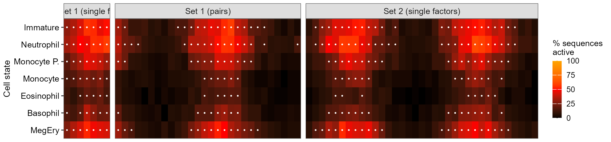
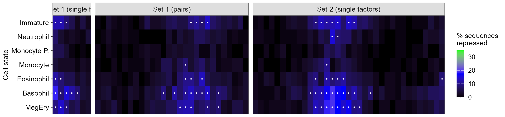
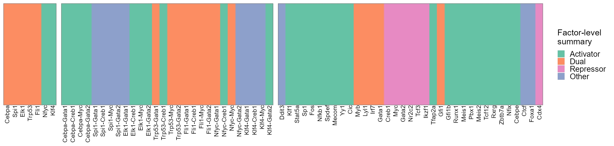
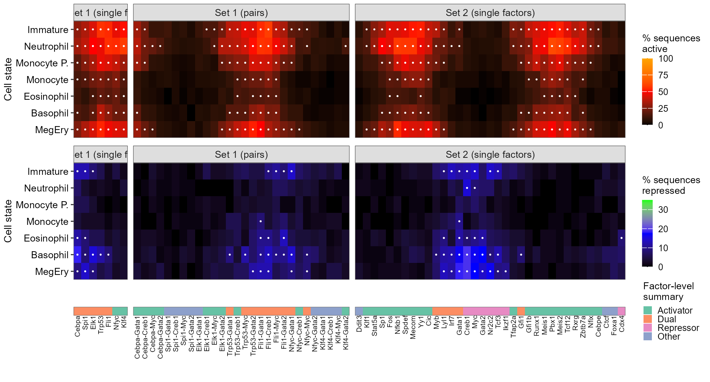
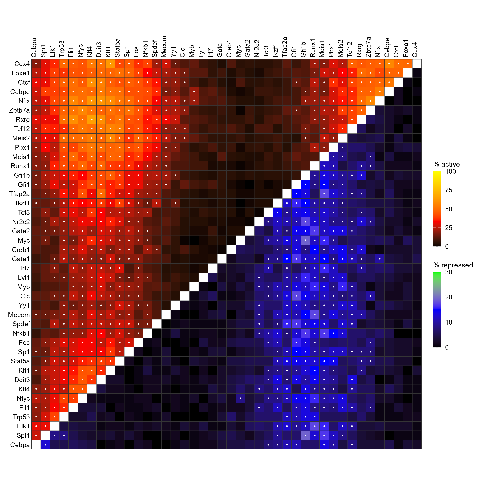

# 增强子激活抑制双热图

Enhancer activation and repression dual heatmaps

**Enhancer activation and repression dual heatmaps**

## 科学问题与应用

转录因子及其组合在不同细胞状态下偏向激活、抑制还是双重作用？

调控元件筛选；细胞状态分面热图及因子配对上下三角双尺度图。

输入、绘图步骤与配色均在 `code/organized.R` 中；数据来源和执行边界见 `provenance.json`。

## 运行

```text
Rscript --vanilla code/organized.R <output-directory>
```

在已经安装依赖的 R 环境中运行；代码不会安装包、访问网络或运行原研究上游流程。输入从本模块定位，不依赖当前工作目录。输出目录通过第一个参数明确传入；不传入时使用 R 会话临时目录。图形维持模板布局与配色；Arial 字体可用时保持该字体。

依赖：ggnewscale, ggplot2, ragg, scales。

## 输入与执行范围

合成示例输入；2个运行期输入表。factor_state_counts.csv：490行×6列；paired_factor_counts.csv：1764行×5列。每个输入的列名和行数见 data_schema.yml。公开版已实际运行，绘图执行范围为合成数据；不是原论文数值或实验结果。

## 独立图像

本模板对应 5 幅独立 PNG，同时生成配对 PDF；它们不合并成一张替代预览。PDF 为运行输出，不随本公共源码分发。

### 08a1_active_panel.png



### 08a2_repressed_panel.png



### 08a3_class_panel.png



### 08a_factor_state_heatmaps.png



### 08b_paired_activity_heatmap.png


