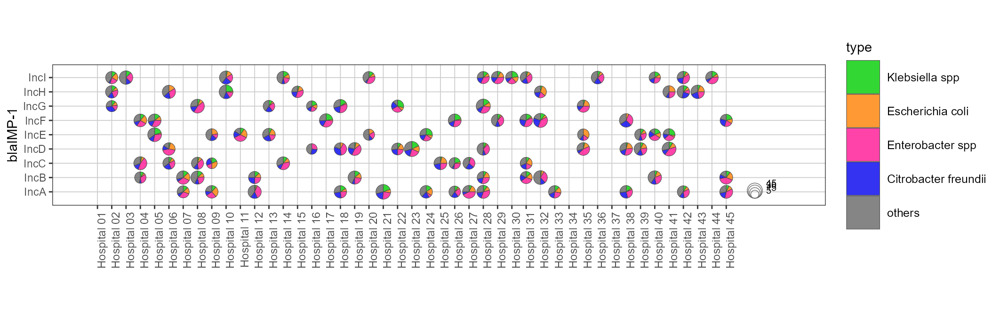
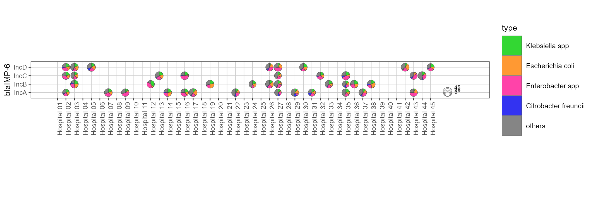
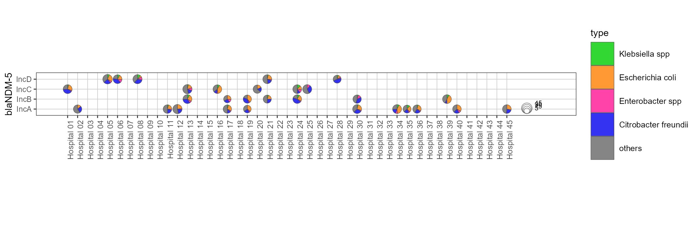
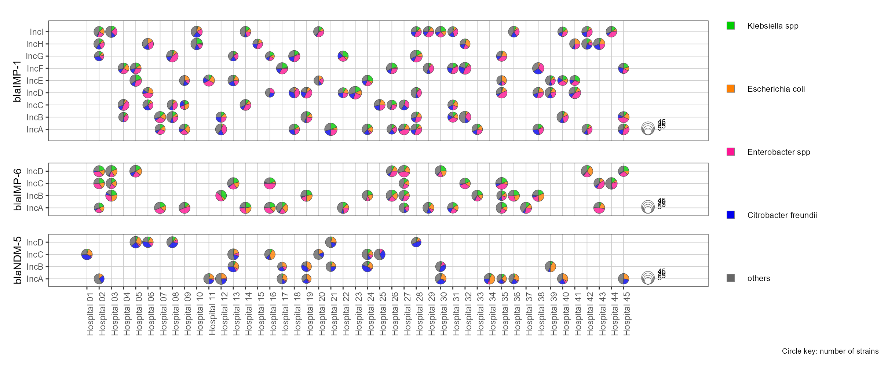

# 医院与质粒类型分面散点饼图

Faceted hospital-plasmid scatter pies

**Faceted hospital-plasmid scatter pies**

## 科学问题与应用

耐药基因、医院、复制子质粒和菌种组成如何联合分布？

五类别组成饼图结合医院/质粒位置，按三种耐药基因分面。

## 运行

```text
Rscript --vanilla code/organized.R <output-directory>
```

在已经安装依赖的 R 环境中运行；代码不会安装包、访问网络或运行原研究上游流程。输入从本模块定位，不依赖当前工作目录。输出目录通过第一个参数明确传入；不传入时使用 R 会话临时目录。图形维持模板布局与配色；Arial 字体可用时保持该字体。

依赖：dplyr, ggforce, ggplot2, ggrepel, patchwork, ragg, scatterpie, tidyr。

## 输入与执行范围

合成示例输入；1个运行期输入表。hospital_plasmids.csv：160行×11列。每个输入的列名和行数见 data_schema.yml。公开版已实际运行，绘图执行范围为合成数据；不是原论文数值或实验结果。

## 独立图像

本模板对应 5 幅独立 PNG，同时生成配对 PDF；它们不合并成一张替代预览。PDF 为运行输出，不随本公共源码分发。

### 08_blaIMP-1.png



### 08_blaIMP-6.png



### 08_blaNDM-5.png



### 08_faceted_scatterpie.png



### 08_strain_size_legend.png


