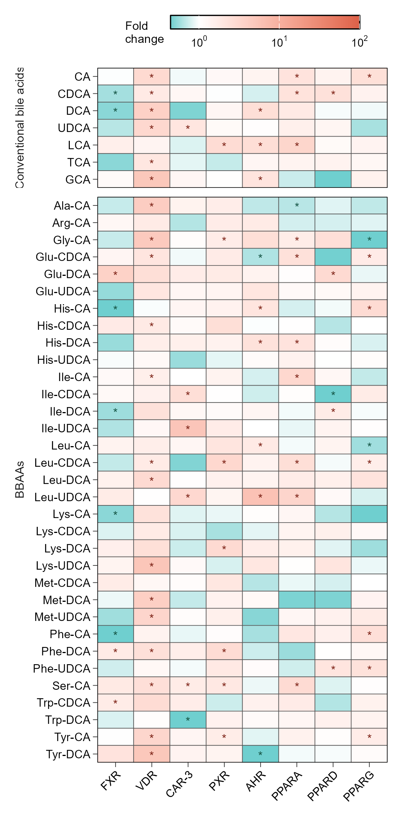

# 显著性星号倍数变化热图

Fold-change heatmap with significance stars

**Fold-change heatmap with significance stars**

## 科学问题与应用

不同处理对代谢物的效应方向、幅度与显著性如何共同呈现？

代谢组或扰动实验的倍数变化；行分类、对数色标与逐格星号。

输入、绘图步骤与配色均在 `code/organized.R` 中；数据来源和执行边界见 `provenance.json`。

## 运行

```text
Rscript --vanilla code/organized.R <output-directory>
```

在已经安装依赖的 R 环境中运行；代码不会安装包、访问网络或运行原研究上游流程。输入从本模块定位，不依赖当前工作目录。输出目录通过第一个参数明确传入；不传入时使用 R 会话临时目录。图形维持模板布局与配色；Arial 字体可用时保持该字体。

依赖：ggplot2, ragg, scales。

## 输入与执行范围

合成示例输入；1个运行期输入表。fold_changes.csv：320行×6列。每个输入的列名和行数见 data_schema.yml。公开版已实际运行，绘图执行范围为合成数据；不是原论文数值或实验结果。

## 独立图像

本模板对应 1 幅独立 PNG，同时生成配对 PDF；它们不合并成一张替代预览。PDF 为运行输出，不随本公共源码分发。

### 05_significance_heatmap.png


