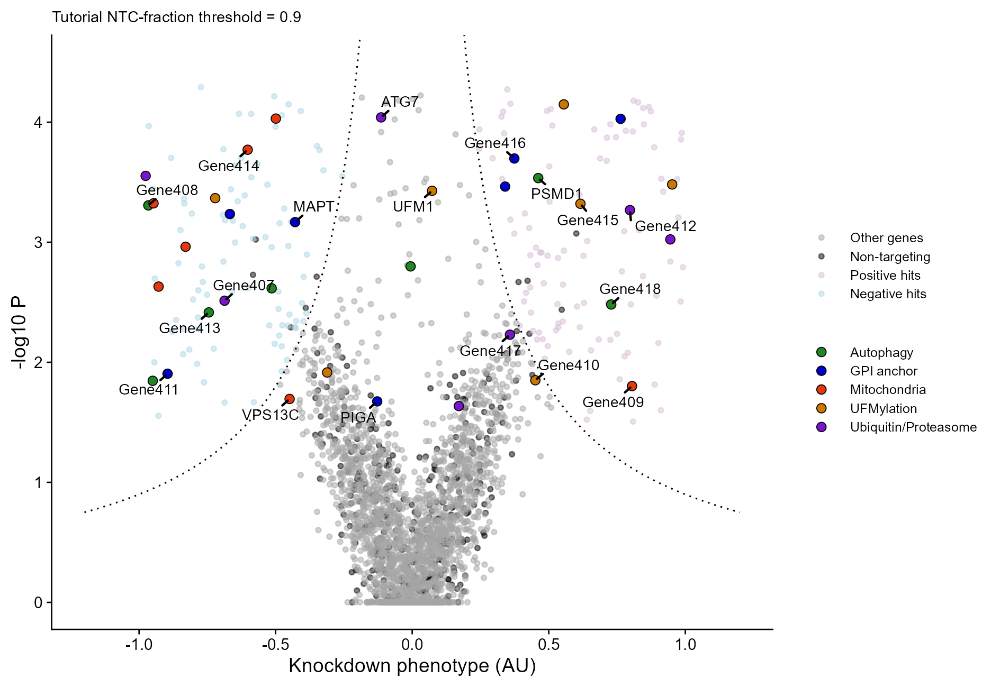
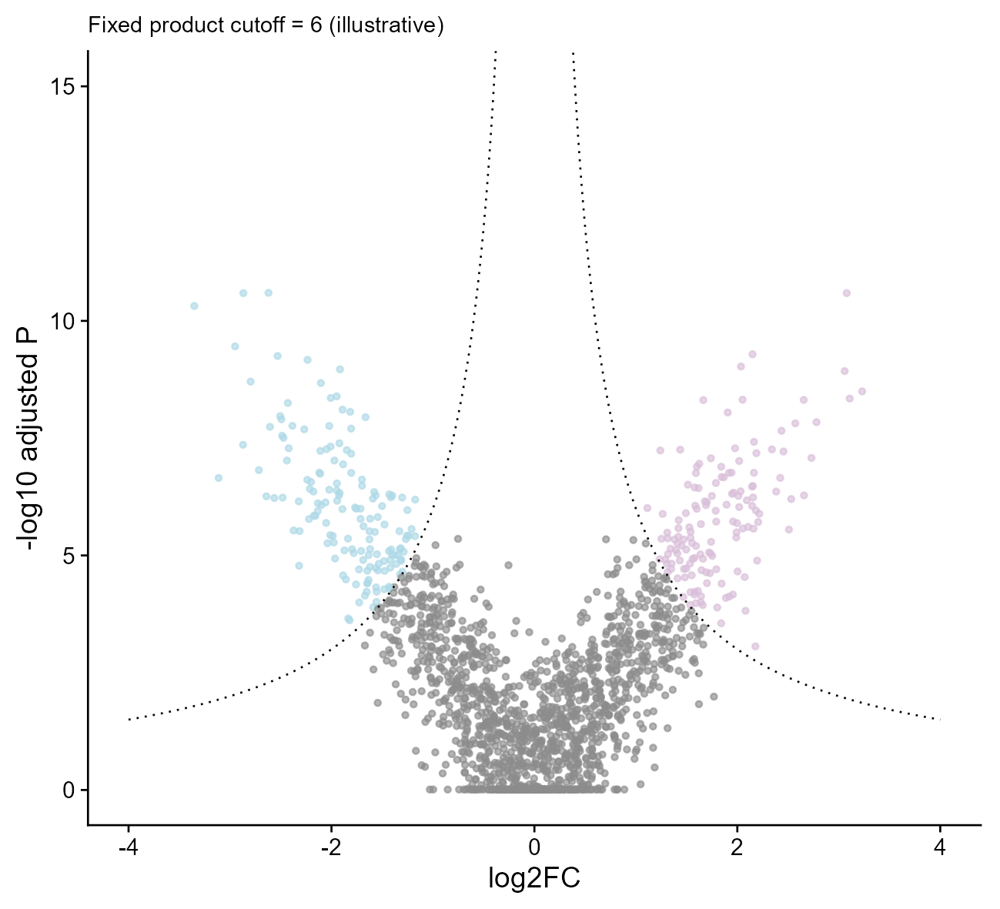
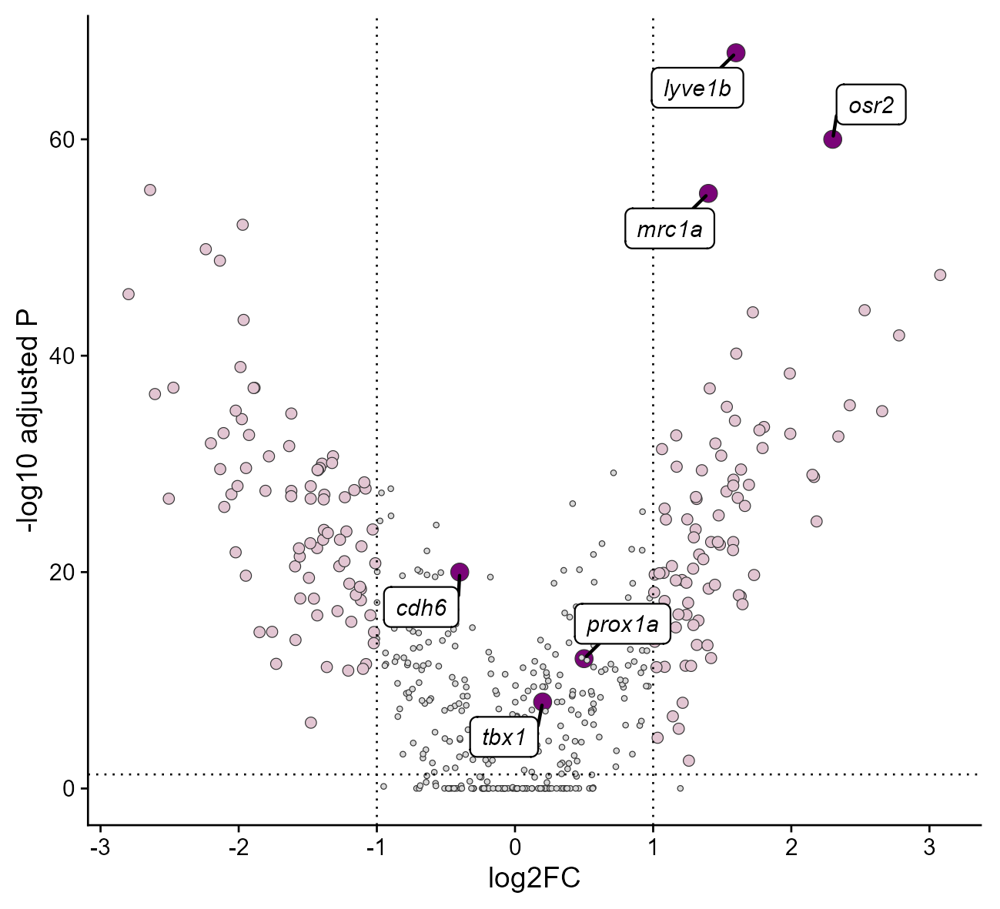

# 双曲线火山图与目标基因高亮

Hyperbolic volcano plots and highlighted targets

**Hyperbolic volcano plots and highlighted targets**

## 科学问题与应用

如何同时呈现效应与显著性并突出通路成员或目标基因？

教程NTC比例扫描、固定乘积阈值和常规阈值三版；仅可视化示例，不替代校准的FDR。

## 运行

```text
Rscript --vanilla code/organized.R <output-directory>
```

在已经安装依赖的 R 环境中运行；代码不会安装包、访问网络或运行原研究上游流程。输入从本模块定位，不依赖当前工作目录。输出目录通过第一个参数明确传入；不传入时使用 R 会话临时目录。图形维持模板布局与配色；Arial 字体可用时保持该字体。

依赖：dplyr, ggplot2, ggrepel, patchwork, ragg, tidyr。

## 输入与执行范围

合成示例输入；3个运行期输入表。crispr_screen.csv：2800行×6列；rna_volcano.csv：1700行×3列。每个输入的列名和行数见 data_schema.yml。公开版已实际运行，绘图执行范围为合成数据；不是原论文数值或实验结果。

## 独立图像

本模板对应 3 幅独立 PNG，同时生成配对 PDF；它们不合并成一张替代预览。PDF 为运行输出，不随本公共源码分发。

### 20a_hyperbolic_crispr.png



### 20b_fixed_hyperbolic_rna.png



### 20c_conventional_interest_genes.png


