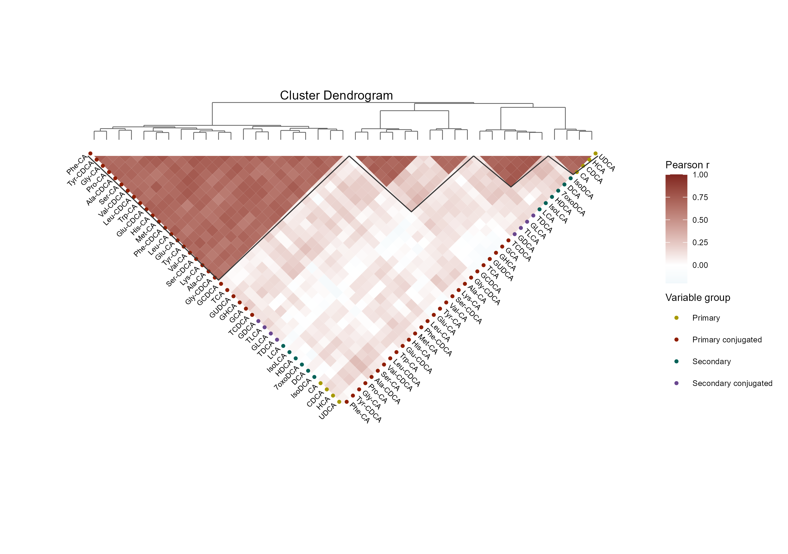

# 倒三角相关性热图与聚类树

Inverted triangular correlation heatmap with dendrogram

**Inverted triangular correlation heatmap with dendrogram**

## 科学问题与应用

哪些变量形成稳定的共变模块，模块之间的关联如何？

代谢物、基因或表型的模块关系概览；聚类树与倒三角热图联合呈现。

输入、绘图步骤与配色均在 `code/organized.R` 中；数据来源和执行边界见 `provenance.json`。

## 运行

```text
Rscript --vanilla code/organized.R <output-directory>
```

在已经安装依赖的 R 环境中运行；代码不会安装包、访问网络或运行原研究上游流程。输入从本模块定位，不依赖当前工作目录。输出目录通过第一个参数明确传入；不传入时使用 R 会话临时目录。图形维持模板布局与配色；Arial 字体可用时保持该字体。

依赖：ggdendro, ggplot2, ragg, scales。

## 输入与执行范围

合成示例输入；2个运行期输入表。bile_acid_observations.csv：100行×42列；variable_groups.csv：41行×2列。每个输入的列名和行数见 data_schema.yml。公开版已实际运行，绘图执行范围为合成数据；不是原论文数值或实验结果。

## 独立图像

本模板对应 1 幅独立 PNG，同时生成配对 PDF；它们不合并成一张替代预览。PDF 为运行输出，不随本公共源码分发。

### 01_inverted_triangle.png


