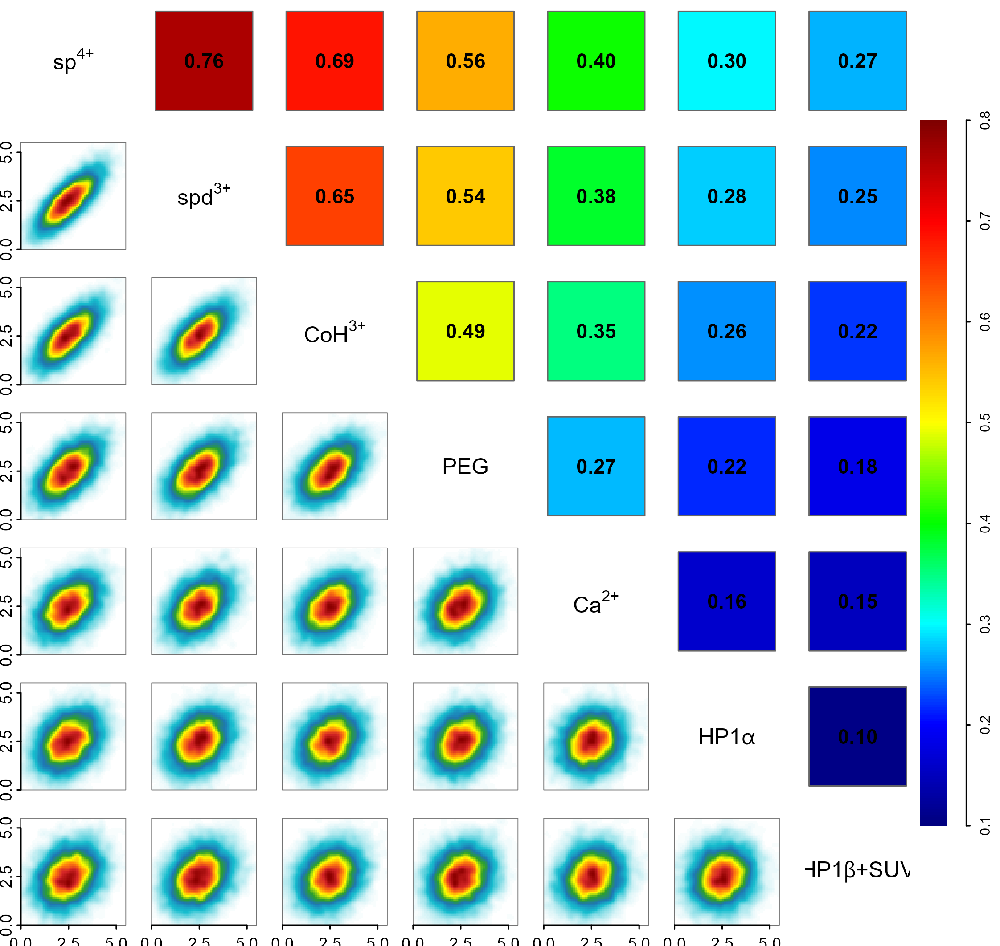
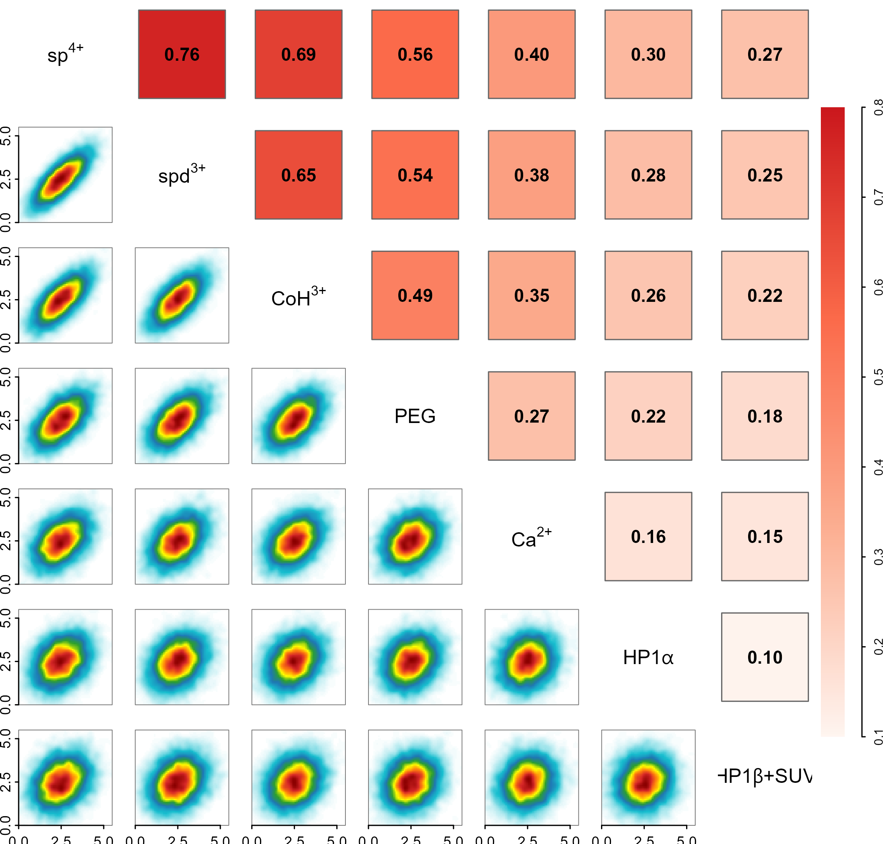

# 核密度相关矩阵R版本

KDE correlation matrix in R

与第11项同一输入和同一Spearman矩阵；下三角改为二维高斯KDE，保留对角变量名、彩虹与红色上三角版本。

## 科学问题与应用

多变量关联的方向与平滑二维密度如何一起查看？

- 展示连续型多指标数据的平滑共分布。
- 比较不同密度估计时保持相关数值与输入不变，避免把平滑程度当成不同生物学结果。

## 运行

```text
Rscript --vanilla code/organized.R <output-directory>
```

在已经安装依赖的 R 环境中运行；代码不会安装包、访问网络或运行原研究上游流程。输入从本模块定位，不依赖当前工作目录。输出目录通过第一个参数明确传入；不传入时使用 R 会话临时目录。图形维持模板布局与配色；Arial 字体可用时保持该字体。

依赖：MASS, dplyr, ggplot2, patchwork, ragg, tidyr。

## 输入与执行范围

合成示例输入；1个运行期输入表。nucleosome_features.csv：9000行×7列。每个输入的列名和行数见 data_schema.yml。公开版已实际运行，绘图执行范围为合成数据；不是原论文数值或实验结果。

## 独立图像

本模板对应 2 幅独立 PNG，同时生成配对 PDF；它们不合并成一张替代预览。PDF 为运行输出，不随本公共源码分发。

### 12_density_matrix_rainbow.png



### 12_density_matrix_red.png


