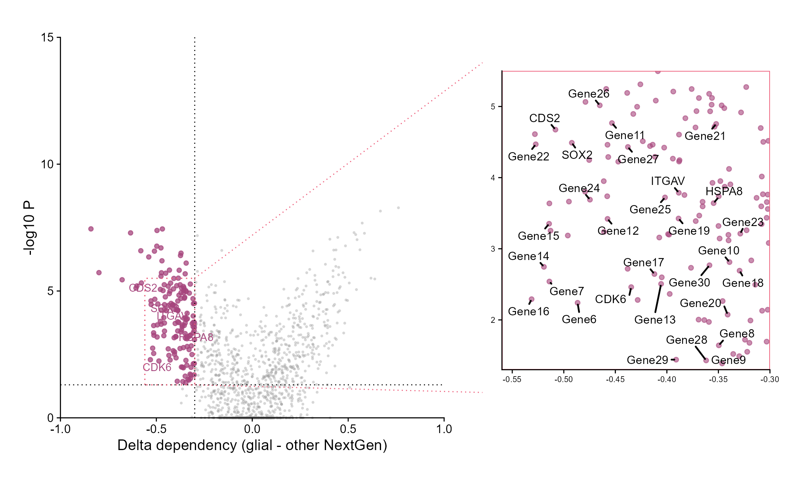
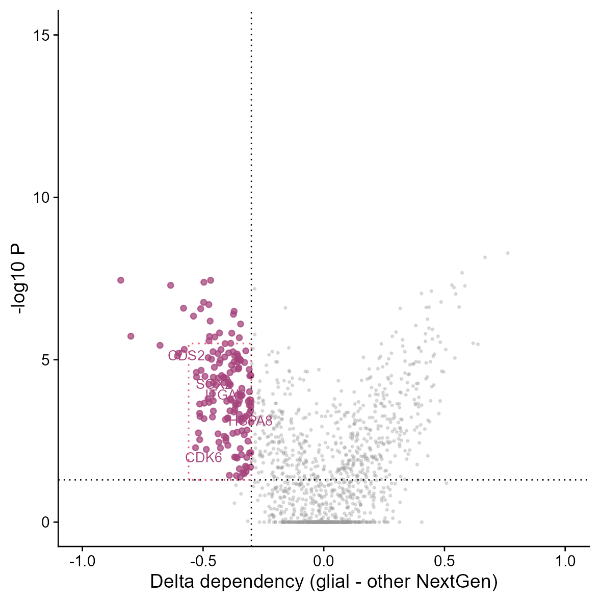
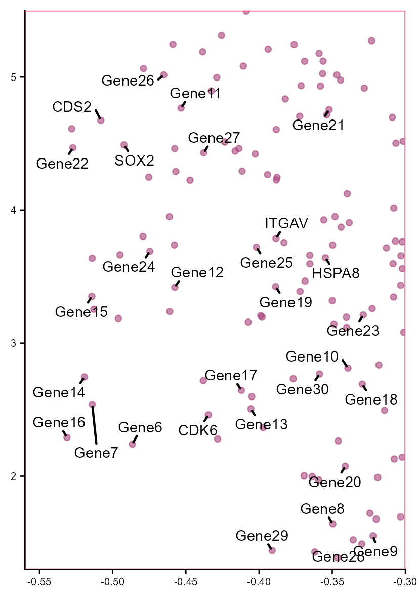
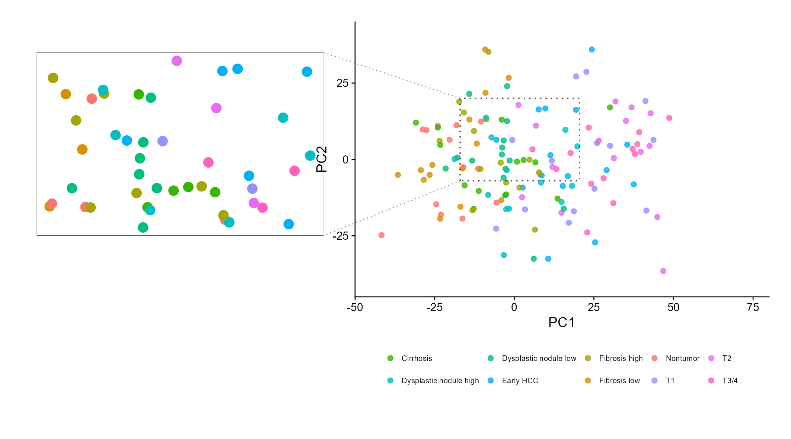
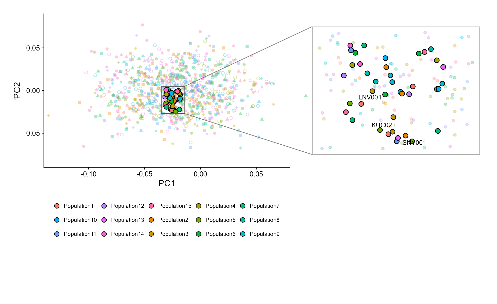
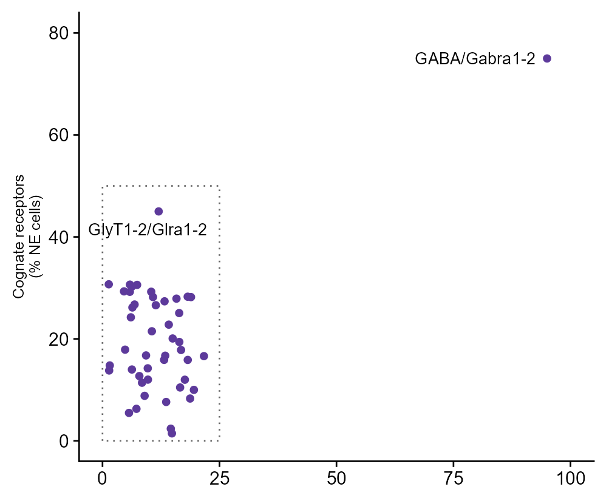
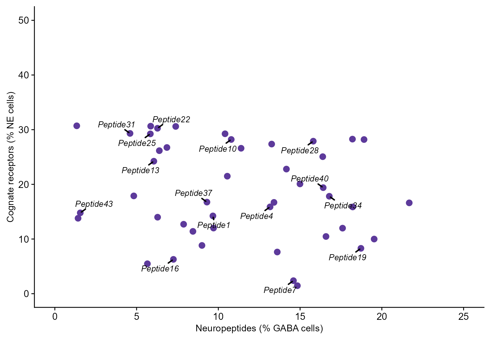
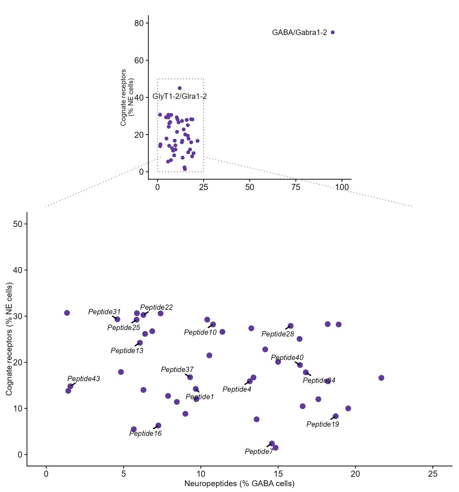

# 四种散点图局部放大布局

Four local-magnification scatter layouts

**Four local-magnification scatter layouts**

## 科学问题与应用

如何同时保留全局分布并显示高密度区域中的关键细节？

火山图右侧放大、PCA左侧放大、古DNA PCA右侧放大、上下全局/局部布局。

## 运行

```text
Rscript --vanilla code/organized.R <output-directory>
```

在已经安装依赖的 R 环境中运行；代码不会安装包、访问网络或运行原研究上游流程。输入从本模块定位，不依赖当前工作目录。输出目录通过第一个参数明确传入；不传入时使用 R 会话临时目录。图形维持模板布局与配色；Arial 字体可用时保持该字体。

依赖：cowplot, dplyr, ggplot2, ggrepel, patchwork, ragg, scales, tidyr。

## 输入与执行范围

合成示例输入；4个运行期输入表。dependency.csv：1300行×5列；pca_samples.csv：140行×4列。每个输入的列名和行数见 data_schema.yml。公开版已实际运行，绘图执行范围为合成数据；不是原论文数值或实验结果。

## 独立图像

本模板对应 8 幅独立 PNG，同时生成配对 PDF；它们不合并成一张替代预览。PDF 为运行输出，不随本公共源码分发。

### 25a_dependency_magnified.png



### 25a_dependency_main.png



### 25a_dependency_zoom.png



### 25b_pca_left_magnifier.png



### 25c_ancient_pca_right_magnifier.png



### 25d_neuropeptide_overview.png



### 25d_neuropeptide_zoom.png



### 25d_overview_and_zoom.png


