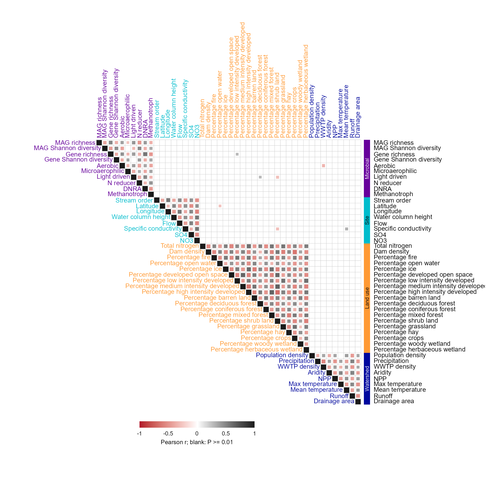
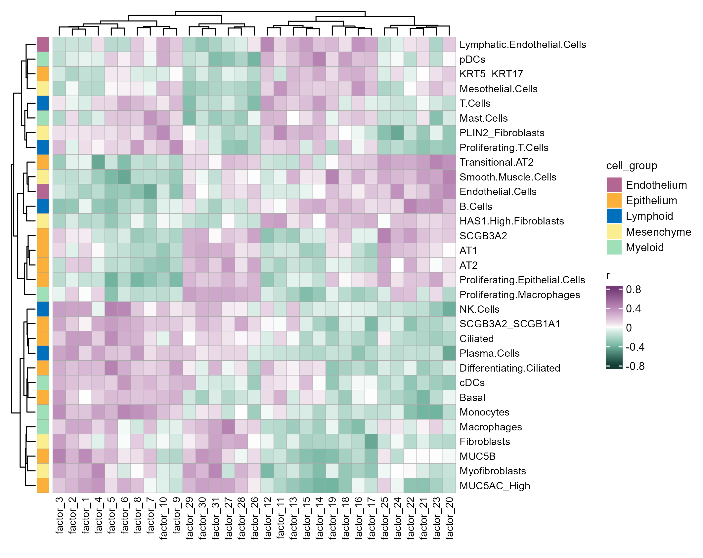
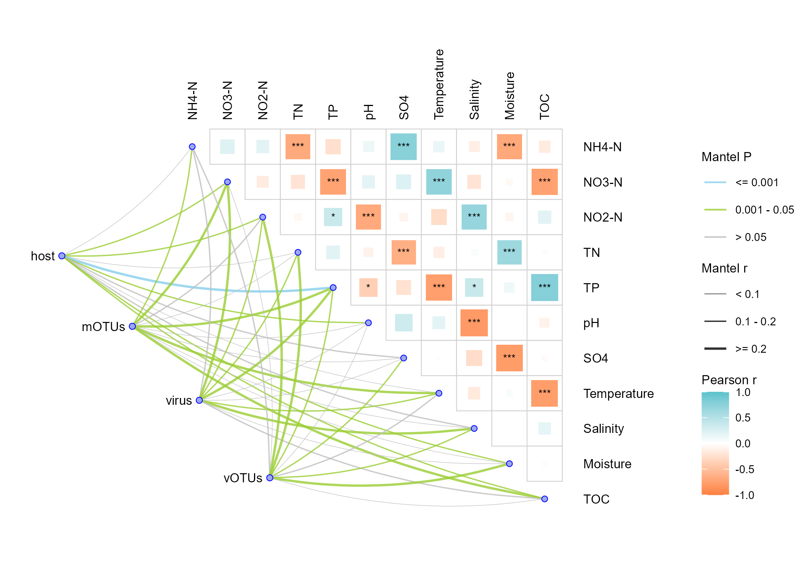

# 一维二维多维相关性可视化

One-, two- and multidimensional correlation visualizations

**One-, two- and multidimensional correlation visualizations**

## 科学问题与应用

单变量关联、跨矩阵关联及群落-环境距离关联如何分别展示？

三个独立变体：分组相关矩阵、跨矩阵聚类热图、Mantel 网络与环境相关矩阵。

输入、绘图步骤与配色均在 `code/organized.R` 中；数据来源和执行边界见 `provenance.json`。

## 运行

```text
Rscript --vanilla code/organized.R <output-directory>
```

在已经安装依赖的 R 环境中运行；代码不会安装包、访问网络或运行原研究上游流程。输入从本模块定位，不依赖当前工作目录。输出目录通过第一个参数明确传入；不传入时使用 R 会话临时目录。图形维持模板布局与配色；Arial 字体可用时保持该字体。

依赖：ComplexHeatmap, RColorBrewer, circlize, ggplot2, ragg, vegan。

## 输入与执行范围

合成示例输入；10个运行期输入表。environment_observations.csv：100行×47列；environment_groups.csv：46行×2列。每个输入的列名和行数见 data_schema.yml。公开版已实际运行，绘图执行范围为合成数据；不是原论文数值或实验结果。

## 独立图像

本模板对应 3 幅独立 PNG，同时生成配对 PDF；它们不合并成一张替代预览。PDF 为运行输出，不随本公共源码分发。

### 07a_grouped_correlation.png



### 07b_cross_matrix_heatmap.png



### 07c_mantel_network.png


