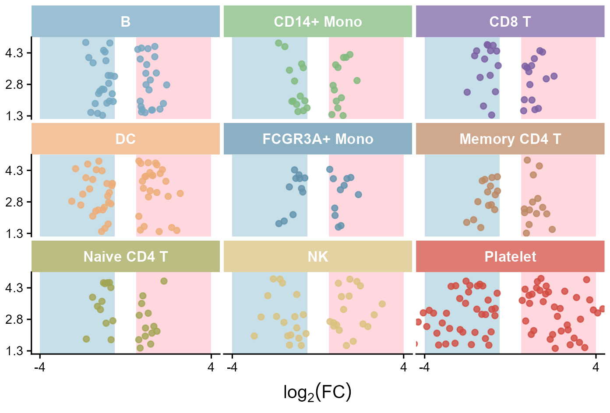
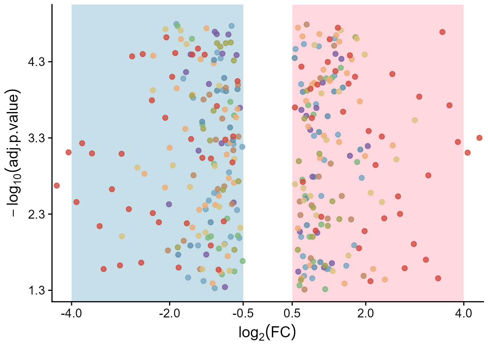
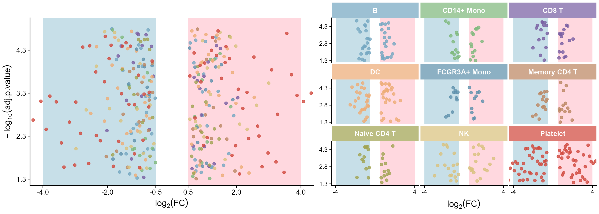
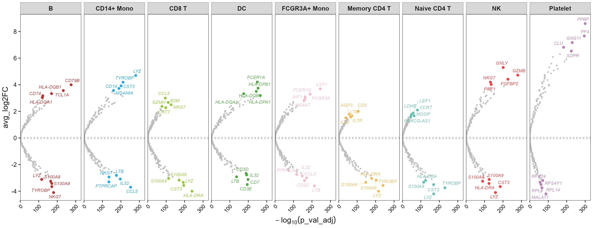
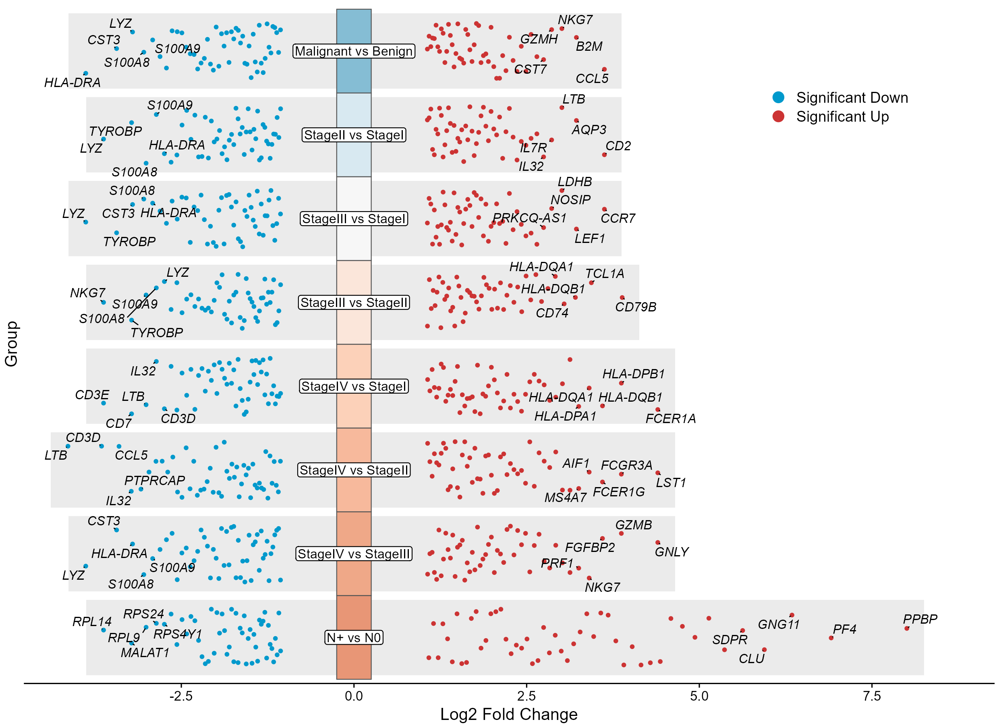

# 三类多分组火山图

Three multi-group volcano layouts

**Three multi-group volcano layouts**

## 科学问题与应用

多个细胞群或比较的差异表达模式和极值基因如何同图比较？

整体加九宫格、横向分面、分类轴抖动火山图三种布局。

## 运行

```text
Rscript --vanilla code/organized.R <output-directory>
```

在已经安装依赖的 R 环境中运行；代码不会安装包、访问网络或运行原研究上游流程。输入从本模块定位，不依赖当前工作目录。输出目录通过第一个参数明确传入；不传入时使用 R 会话临时目录。图形维持模板布局与配色；Arial 字体可用时保持该字体。

依赖：cowplot, dplyr, ggplot2, ggrepel, patchwork, ragg, scales, tidyr。

## 输入与执行范围

合成示例输入；2个运行期输入表。group_volcano.csv：1350行×5列；group_volcano3.csv：800行×5列。每个输入的列名和行数见 data_schema.yml。公开版已实际运行，绘图执行范围为合成数据；不是原论文数值或实验结果。

## 独立图像

本模板对应 5 幅独立 PNG，同时生成配对 PDF；它们不合并成一张替代预览。PDF 为运行输出，不随本公共源码分发。

### 15a_nine_facets.png



### 15a_overlaid_volcano.png



### 15a_overview_and_facets.png



### 15b_horizontal_facets.png



### 15c_multigroup_jitter_volcano.png


