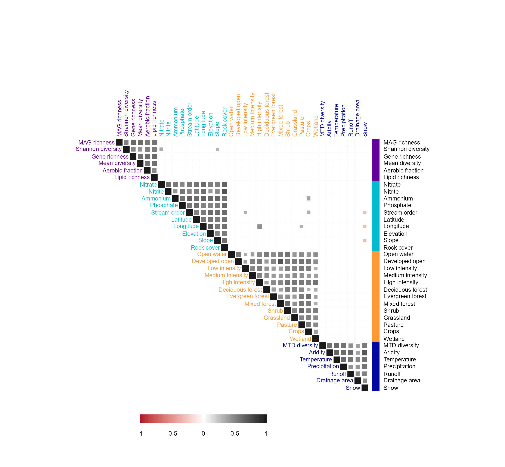
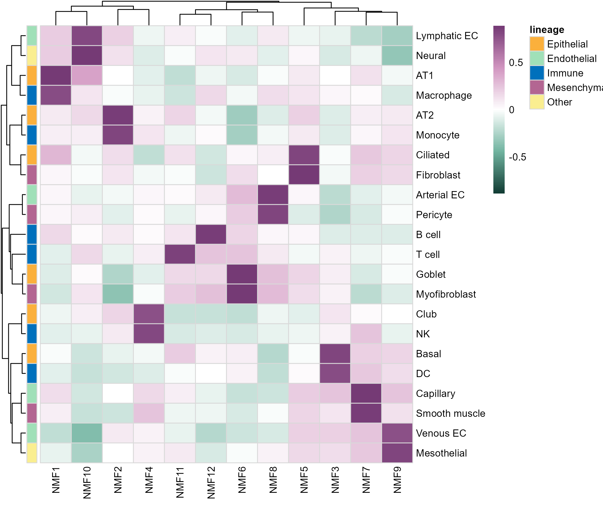
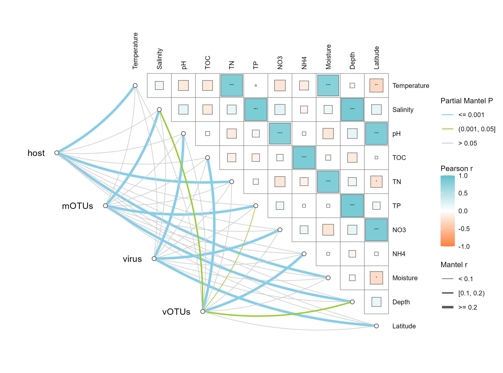

# 一维二维多维相关性热图

Multiscale correlation heatmaps

保留文章的三类表达：按变量组着色的显著相关三角矩阵、细胞类型与NMF因子的双向聚类热图、环境相关矩阵与partial Mantel网络。三幅图分别保存，避免把不同统计对象混成一张相关图。

## 科学问题与应用

单组变量、两类特征及群落与环境的关联分别如何展示？

- 用分组矩阵比较水质、地理和微生物指标。
- 比较细胞类型与NMF因子，或用距离矩阵检验群落与环境的关联；具体解释仍受距离和置换设计约束。

## 运行

```text
Rscript --vanilla code/organized.R <output-directory>
```

在已经安装依赖的 R 环境中运行；代码不会安装包、访问网络或运行原研究上游流程。输入从本模块定位，不依赖当前工作目录。输出目录通过第一个参数明确传入；不传入时使用 R 会话临时目录。图形维持模板布局与配色；Arial 字体可用时保持该字体。

依赖：circlize, dplyr, ggplot2, linkET, patchwork, pheatmap, ragg, tidyr。

## 输入与执行范围

合成示例输入；7个运行期输入表。environment_variables.csv：75行×37列；environment_groups.csv：36行×2列。每个输入的列名和行数见 data_schema.yml。公开版已实际运行，绘图执行范围为合成数据；不是原论文数值或实验结果。

## 独立图像

本模板对应 3 幅独立 PNG，同时生成配对 PDF；它们不合并成一张替代预览。PDF 为运行输出，不随本公共源码分发。

### 02a_grouped_environment_correlation.png



### 02b_cell_factor_clustered_heatmap.png



### 02c_mantel_environment_network.png


