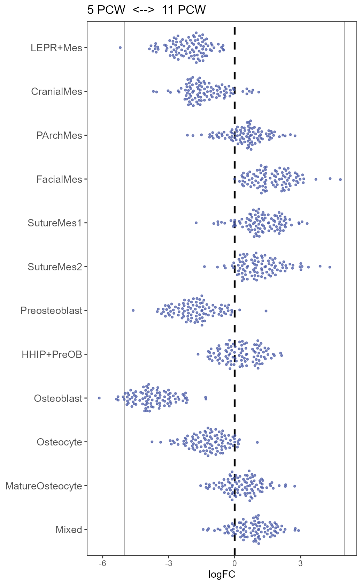
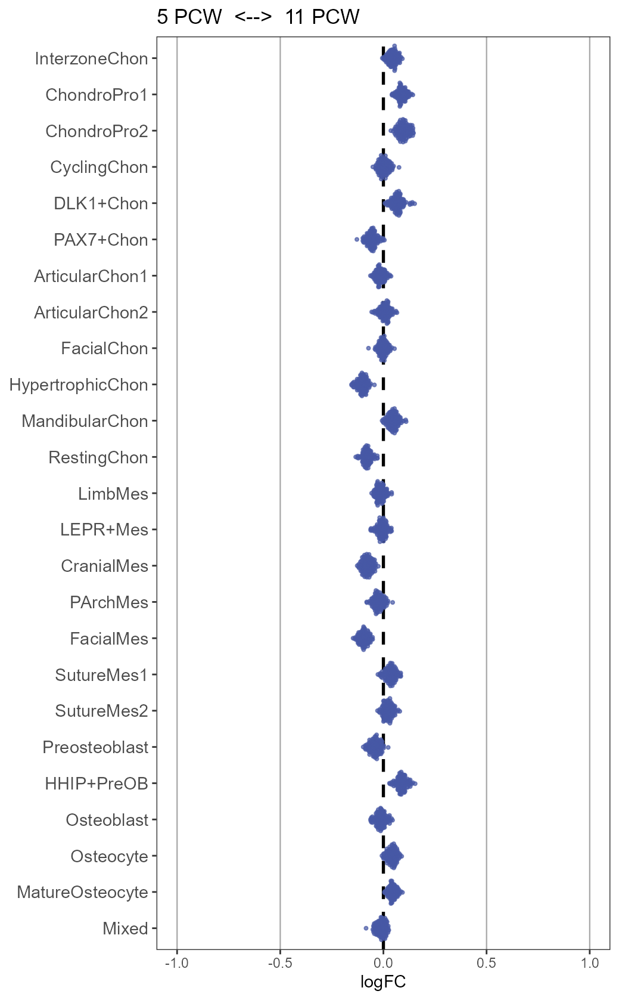
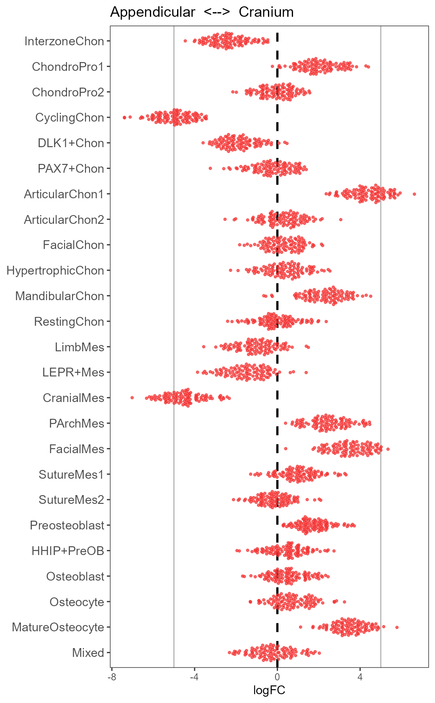
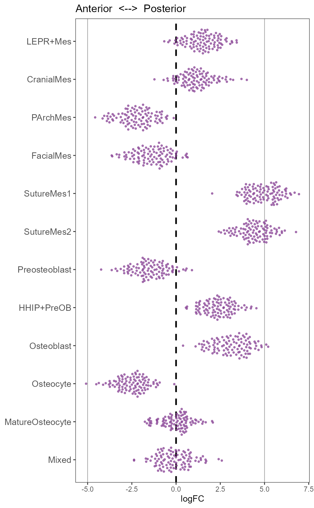
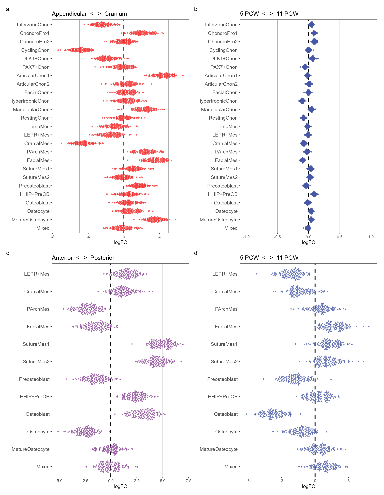
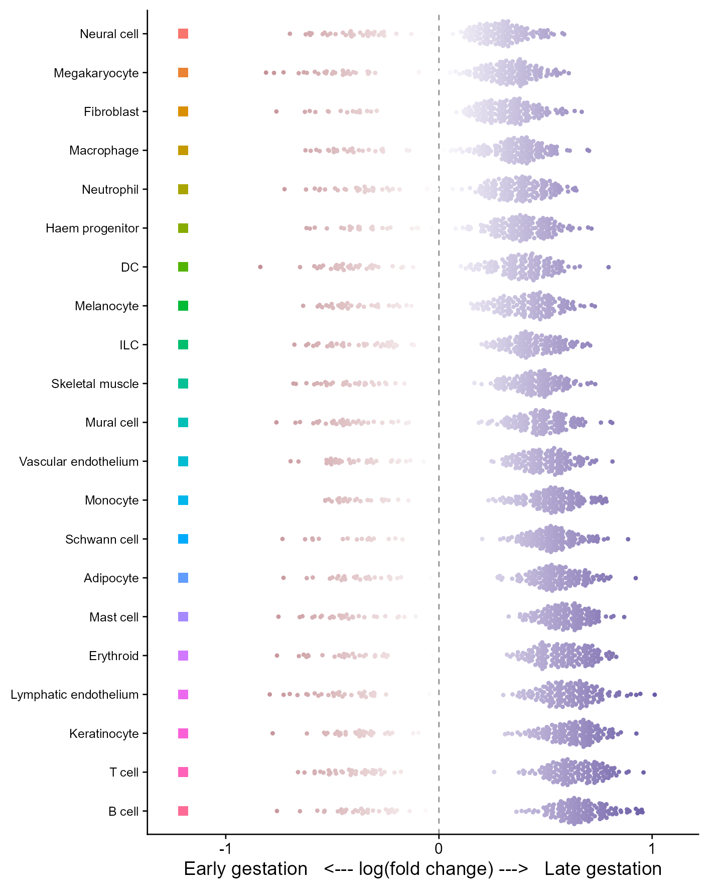

# 邻域丰度差异蜂群图

Neighbourhood differential-abundance beeswarms

**Neighbourhood differential-abundance beeswarms**

## 科学问题与应用

不同细胞类型中的邻域丰度效应如何沿空间或时间对比变化？

接收预计算的邻域logFC；骨骼四个对比和皮肤早晚妊娠连续色版本。

## 运行

```text
Rscript --vanilla code/organized.R <output-directory>
```

在已经安装依赖的 R 环境中运行；代码不会安装包、访问网络或运行原研究上游流程。输入从本模块定位，不依赖当前工作目录。输出目录通过第一个参数明确传入；不传入时使用 R 会话临时目录。图形维持模板布局与配色；Arial 字体可用时保持该字体。

依赖：dplyr, ggbeeswarm, ggplot2, ggrepel, patchwork, ragg, tidyr。

## 输入与执行范围

合成示例输入；2个运行期输入表。neighbourhoods.csv：7400行×4列；skin_neighbourhoods.csv：3780行×4列。每个输入的列名和行数见 data_schema.yml。公开版已实际运行，绘图执行范围为合成数据；不是原论文数值或实验结果。

## 独立图像

本模板对应 6 幅独立 PNG，同时生成配对 PDF；它们不合并成一张替代预览。PDF 为运行输出，不随本公共源码分发。

### 11_age_cranial.png



### 11_age_skeleton.png



### 11_anterior_posterior.png



### 11_cranial_axis.png



### 11a_skeleton_beeswarm.png



### 11b_skin_beeswarm.png


