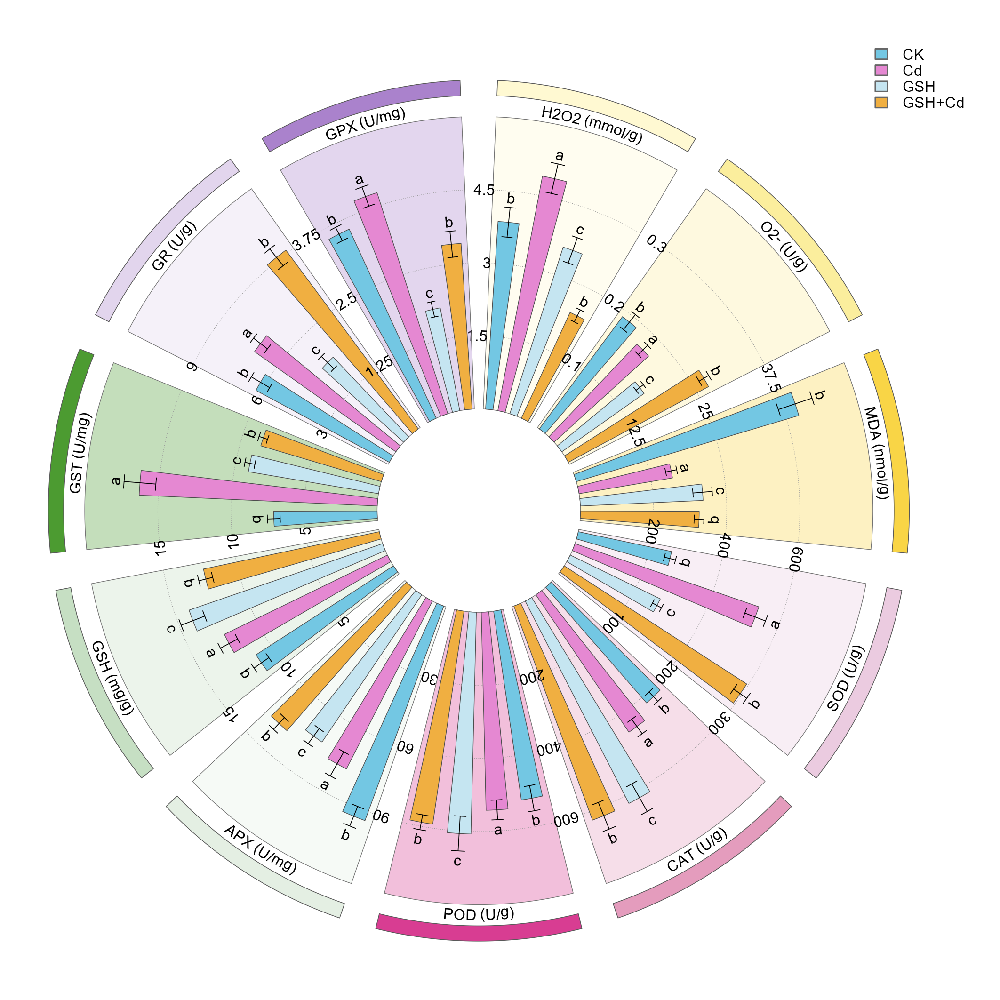

# 抗氧化指标环形柱与误差线

Circular antioxidant bars with error intervals

*Circular antioxidant bars with error intervals*

## 科学问题与应用

四种处理下的氧化应激和抗氧化指标如何变化？

Cd与GSH处理的多指标可视化；植物抗氧化指标面板。

## 运行

```text
Rscript --vanilla code/organized.R <output-directory>
```

在已经安装依赖的 R 环境中运行；代码不会安装包、访问网络或运行原研究上游流程。输入从本模块定位，不依赖当前工作目录。输出目录通过第一个参数明确传入；不传入时使用 R 会话临时目录。图形维持模板布局与配色；Arial 字体可用时保持该字体。

依赖：ragg。

## 输入与执行范围

合成示例输入；1个运行期输入表。antioxidant_traits.csv：44行×6列。每个输入的列名和行数见 data_schema.yml。公开版已实际运行，绘图执行范围为合成数据；不是原论文数值或实验结果。

## 独立图像

本模板对应 1 幅独立 PNG，同时生成配对 PDF；它们不合并成一张替代预览。PDF 为运行输出，不随本公共源码分发。

### 07_antioxidant_polar_errorbars.png


