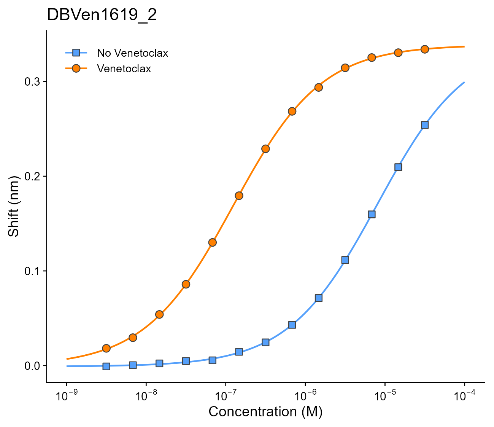
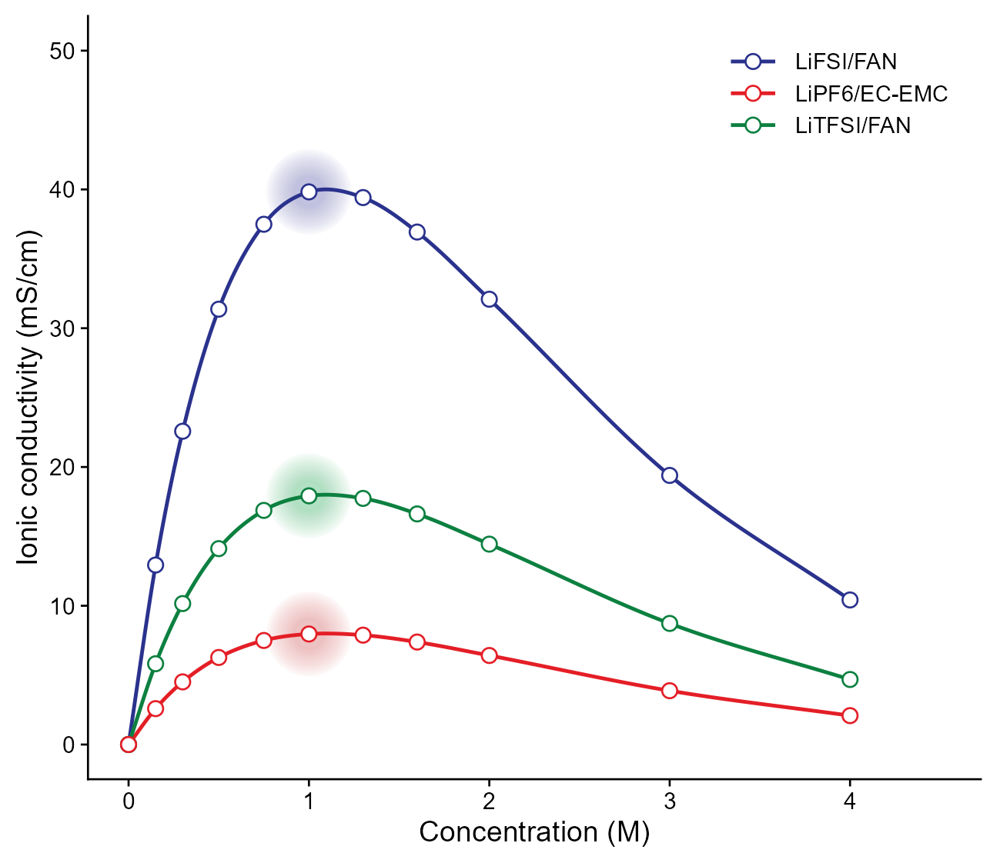
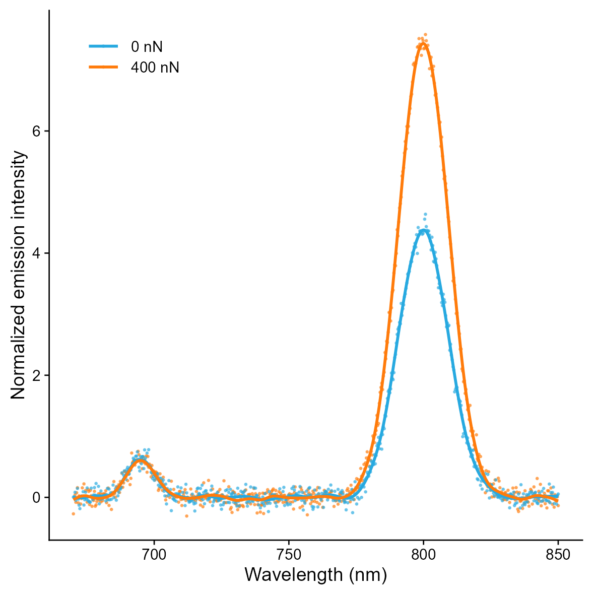

# 三种平滑散点曲线

Three smooth scatter-curve patterns

**Three smooth scatter-curve patterns**

## 科学问题与应用

剂量响应、单峰变化与光谱峰形分别适用什么平滑方法？

四参数logistic响应、导电性形状保持样条、光谱平滑样条。

## 运行

```text
Rscript --vanilla code/organized.R <output-directory>
```

在已经安装依赖的 R 环境中运行；代码不会安装包、访问网络或运行原研究上游流程。输入从本模块定位，不依赖当前工作目录。输出目录通过第一个参数明确传入；不传入时使用 R 会话临时目录。图形维持模板布局与配色；Arial 字体可用时保持该字体。

依赖：dplyr, ggplot2, ggrepel, patchwork, ragg, scales, tidyr。

## 输入与执行范围

合成示例输入；3个运行期输入表。dose_response.csv：26行×3列；conductivity.csv：33行×3列。每个输入的列名和行数见 data_schema.yml。公开版已实际运行，绘图执行范围为合成数据；不是原论文数值或实验结果。

## 独立图像

本模板对应 3 幅独立 PNG，同时生成配对 PDF；它们不合并成一张替代预览。PDF 为运行输出，不随本公共源码分发。

### 05a_logistic_dose_response.png



### 05b_conductivity_spline.png



### 05c_spectral_smoothing.png


