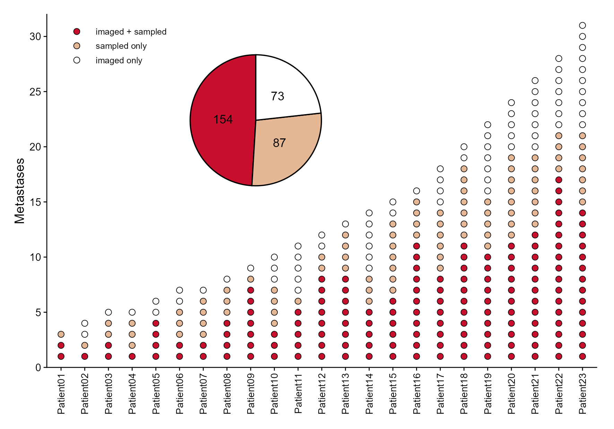
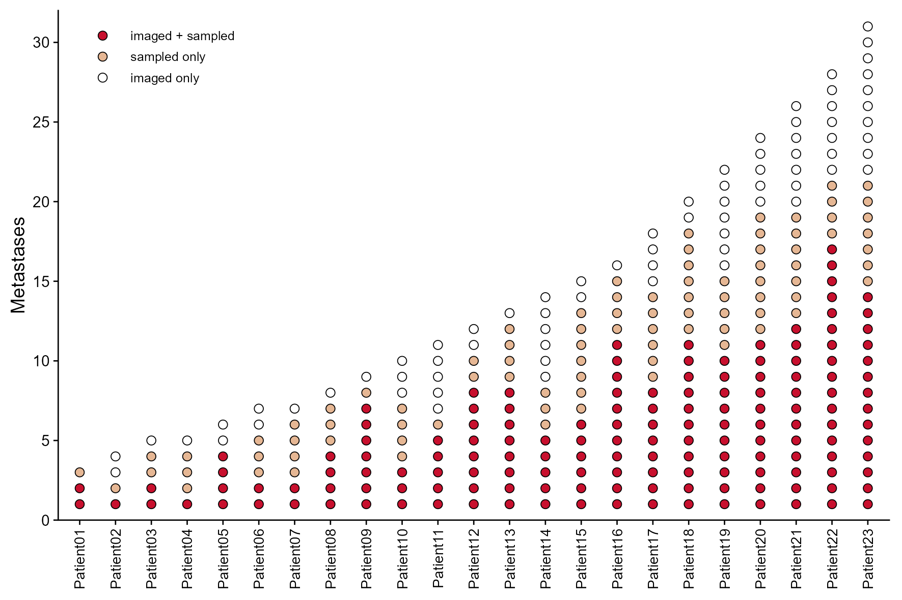
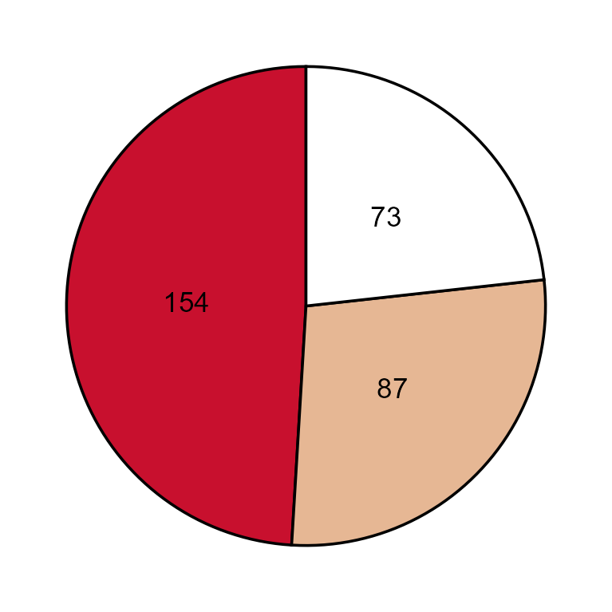

# 堆积病灶点图与内嵌饼图

Stacked lesion dots with an inset summary pie

**Stacked lesion dots with an inset summary pie**

## 科学问题与应用

每个对象的观测是否被采样覆盖，整体覆盖比例是多少？

逐病灶计数并按患者总量排序，饼图汇总三种成像/采样状态。

## 运行

```text
Rscript --vanilla code/organized.R <output-directory>
```

在已经安装依赖的 R 环境中运行；代码不会安装包、访问网络或运行原研究上游流程。输入从本模块定位，不依赖当前工作目录。输出目录通过第一个参数明确传入；不传入时使用 R 会话临时目录。图形维持模板布局与配色；Arial 字体可用时保持该字体。

依赖：dplyr, ggplot2, ggrepel, patchwork, ragg, tidyr。

## 输入与执行范围

合成示例输入；1个运行期输入表。metastases.csv：314行×2列。每个输入的列名和行数见 data_schema.yml。公开版已实际运行，绘图执行范围为合成数据；不是原论文数值或实验结果。

## 独立图像

本模板对应 3 幅独立 PNG，同时生成配对 PDF；它们不合并成一张替代预览。PDF 为运行输出，不随本公共源码分发。

### 22_stacked_dot_inset_pie.png



### 22a_stacked_dots.png



### 22b_summary_pie.png


