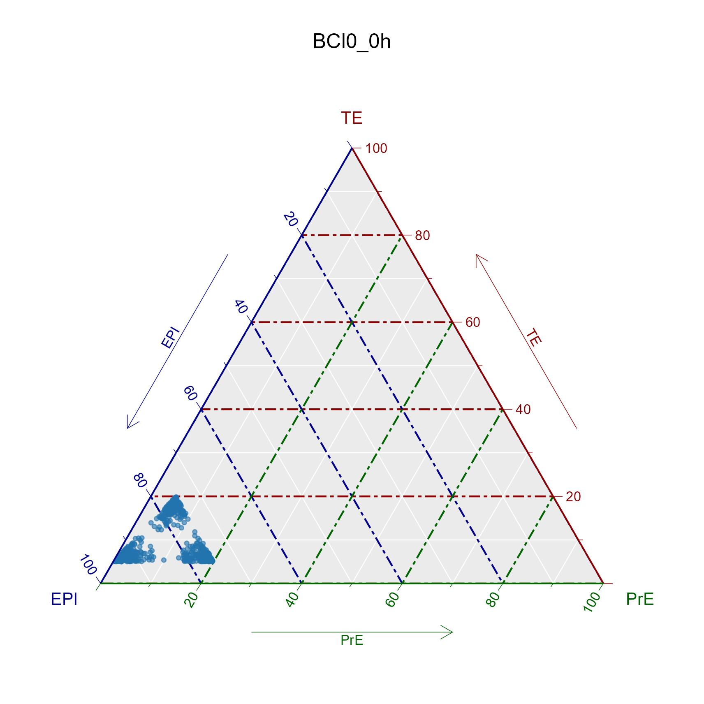
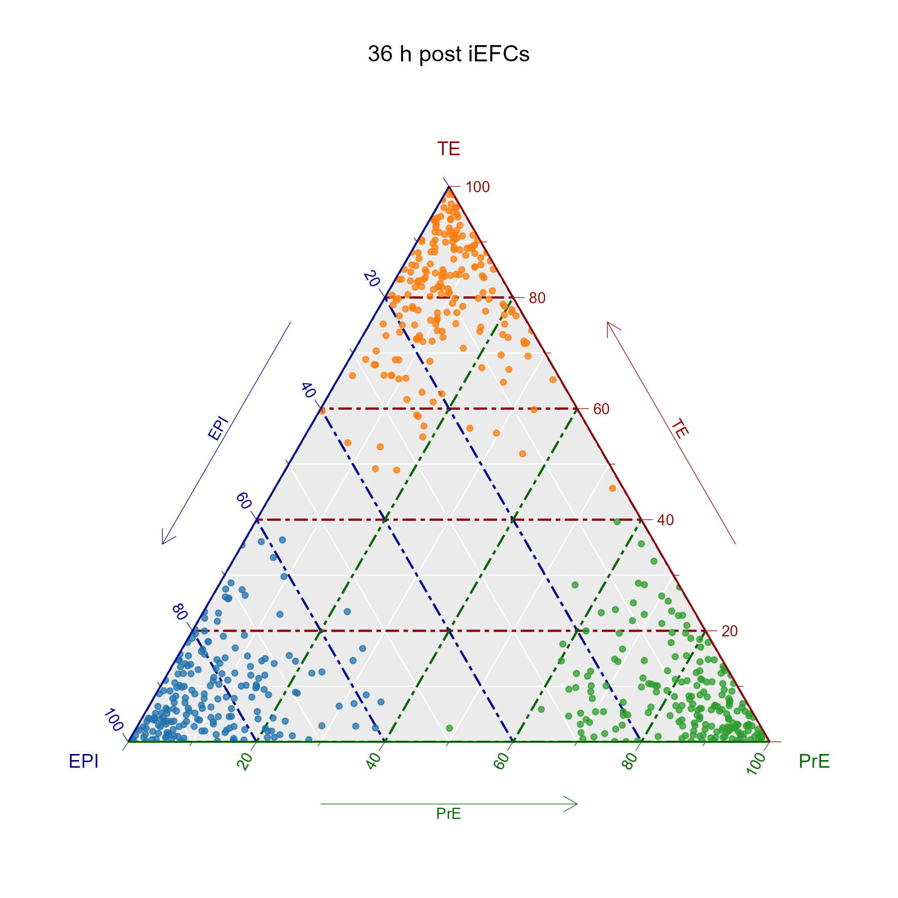
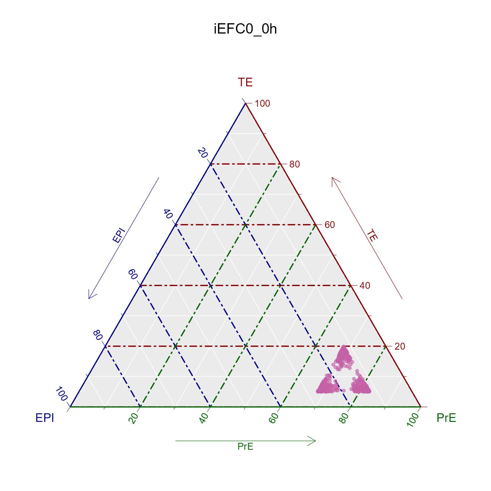
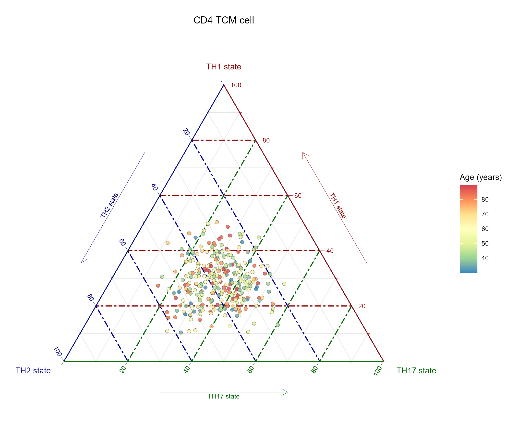
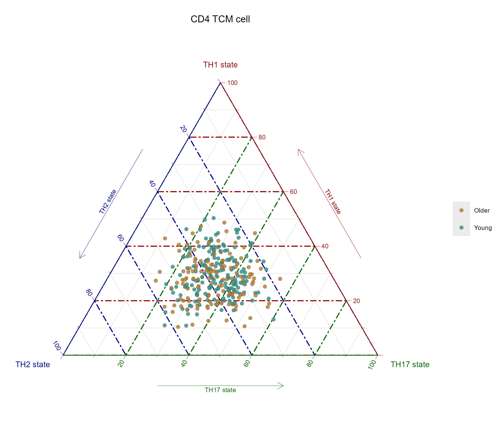
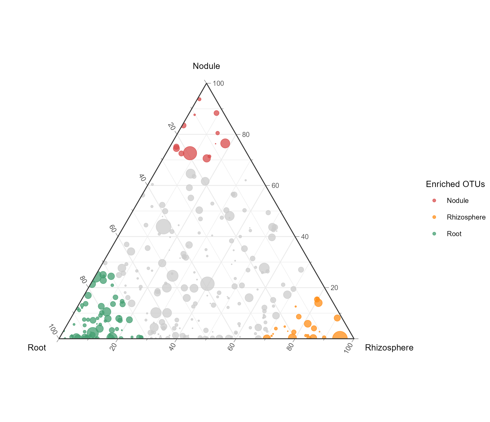
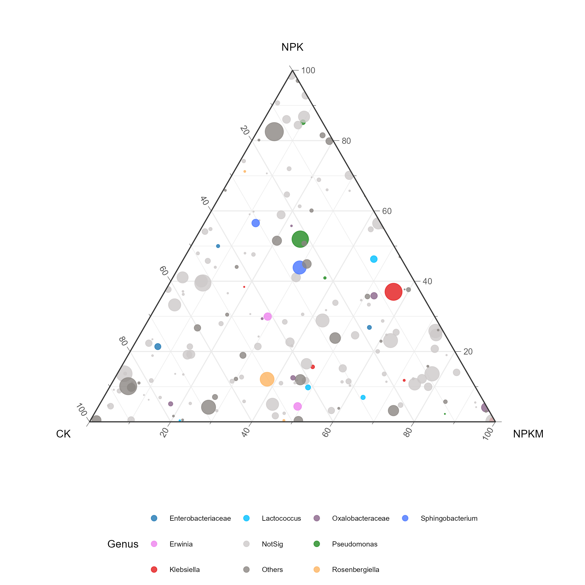
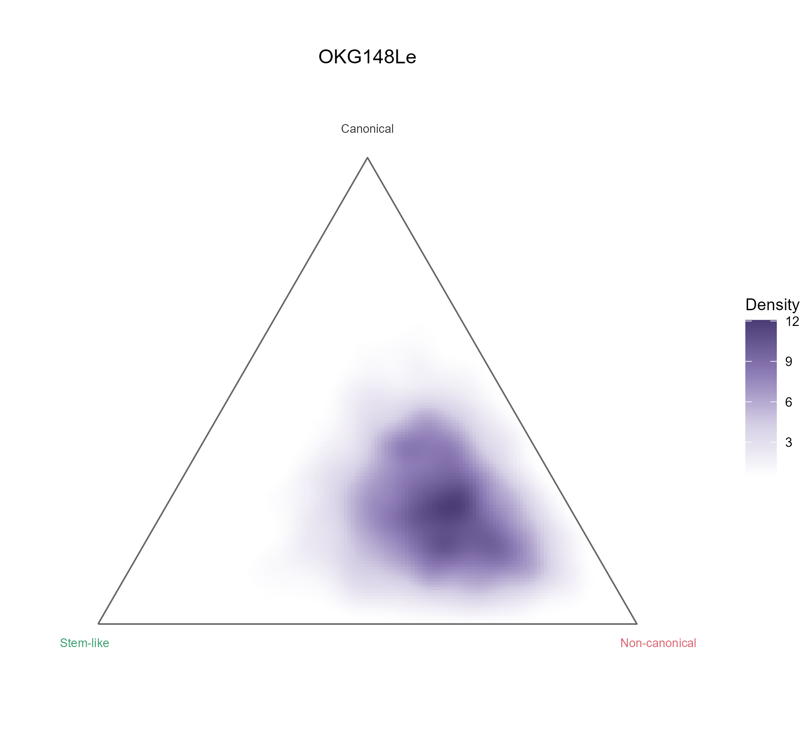
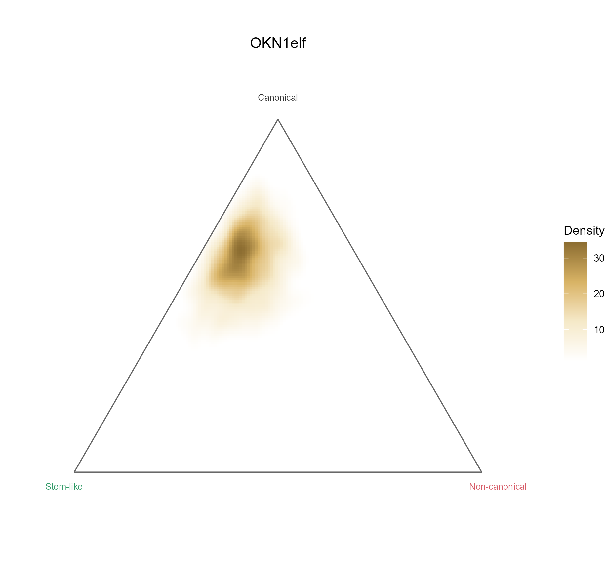

# 五类三元图与状态概率密度

Ternary plots and state densities

覆盖胚胎谱系、T细胞状态（年龄组与连续年龄两图）、微生物生态位、施肥条件属组成、两种肿瘤状态概率密度，共7幅。各输入前三个坐标均非负且和为1，密度图在二维投影后作KDE并掩去三角外区域。

## 科学问题与应用

一个细胞、OTU或样本如何在三种相对状态或环境间分配？

- 展示三个归一化signature或概率之间的相对偏向。
- 用气泡大小保留OTU丰度，或用密度表达大量对象的连续归属；不能从归一化比例推断绝对数量。

## 运行

```text
Rscript --vanilla code/organized.R <output-directory>
```

在已经安装依赖的 R 环境中运行；代码不会安装包、访问网络或运行原研究上游流程。输入从本模块定位，不依赖当前工作目录。输出目录通过第一个参数明确传入；不传入时使用 R 会话临时目录。图形维持模板布局与配色；Arial 字体可用时保持该字体。

依赖：MASS, dplyr, ggplot2, ggtern, patchwork, ragg, tidyr。

## 输入与执行范围

合成示例输入；5个运行期输入表。embryo_lineages.csv：600行×4列；immune_states.csv：310行×5列。每个输入的列名和行数见 data_schema.yml。公开版已实际运行，绘图执行范围为合成数据；不是原论文数值或实验结果。

## 独立图像

本模板对应 9 幅独立 PNG，同时生成配对 PDF；它们不合并成一张替代预览。PDF 为运行输出，不随本公共源码分发。

### 10a_BCl0_0h.png



### 10a_embryo_lineages.png



### 10a_iEFC0_0h.png



### 10b_immune_state_age.png



### 10b_immune_state_group.png



### 10c_microbe_niche_bubbles.png



### 10d_fertilizer_genus_bubbles.png



### 10e_state_density_OKG148Le.png



### 10e_state_density_OKN1elf.png


