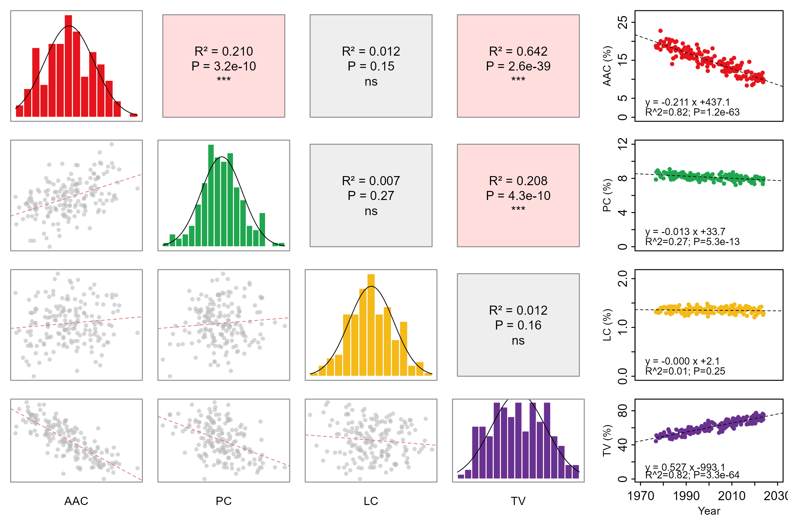

# 水稻性状相关矩阵与年代趋势

Rice trait matrix and year trends

将四个性状的分布、两两关系和年代变化同时摆在一张图中。对角线是直方图与高斯曲线，下三角是散点和线性拟合，上三角给出由输入表实际计算的R平方与P值，右侧按性状展示年份趋势。

## 科学问题与应用

多个品质性状如何相互关联，各性状是否随育成年份变化？

- 比较植物品种的品质性状，观察哪些性状的变化相互伴随。
- 在育种或长期调查数据中，区分性状之间的相关与随时间的整体趋势。

## 运行

```text
Rscript --vanilla code/organized.R <output-directory>
```

在已经安装依赖的 R 环境中运行；代码不会安装包、访问网络或运行原研究上游流程。输入从本模块定位，不依赖当前工作目录。输出目录通过第一个参数明确传入；不传入时使用 R 会话临时目录。图形维持模板布局与配色；Arial 字体可用时保持该字体。

依赖：dplyr, ggplot2, patchwork, ragg, tidyr。

## 输入与执行范围

合成示例输入；1个运行期输入表。rice_traits.csv：170行×5列。每个输入的列名和行数见 data_schema.yml。公开版已实际运行，绘图执行范围为合成数据；不是原论文数值或实验结果。

## 独立图像

本模板对应 1 幅独立 PNG，同时生成配对 PDF；它们不合并成一张替代预览。PDF 为运行输出，不随本公共源码分发。

### 01_rice_matrix_year_trends.png


