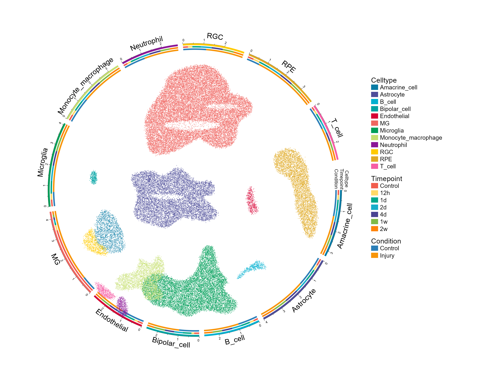
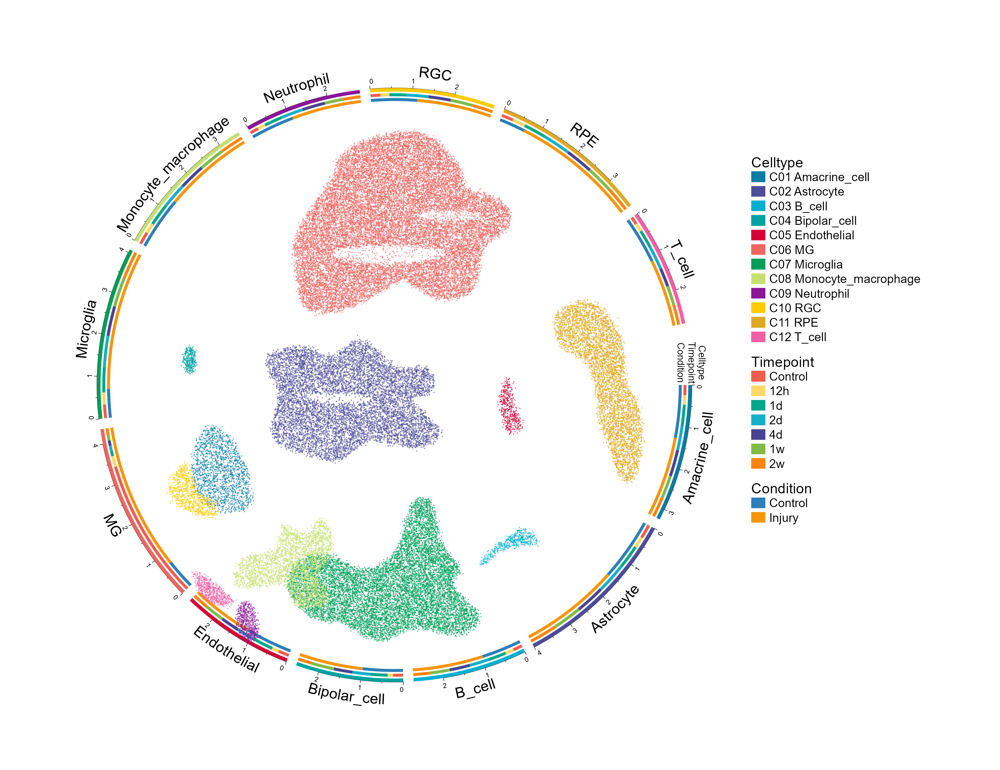
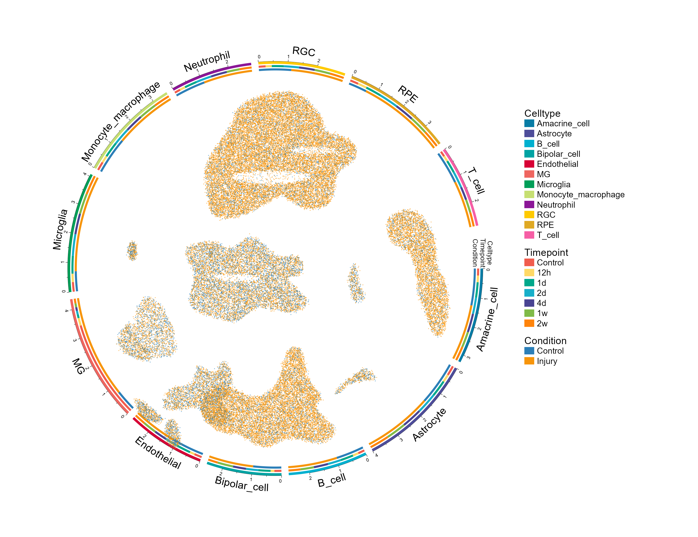
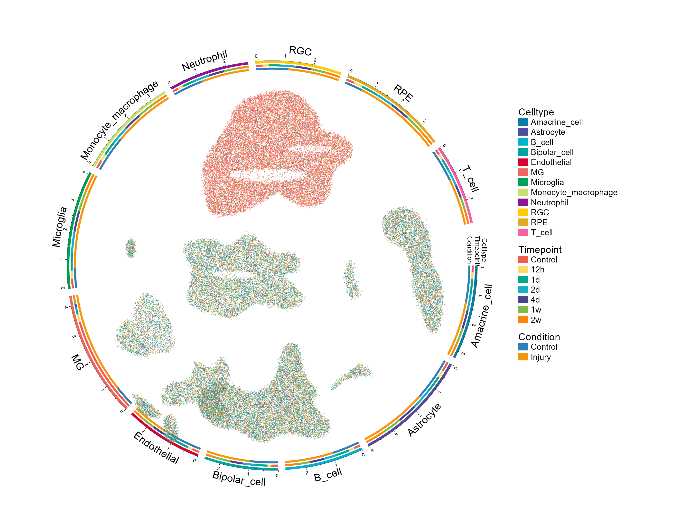

# 环形多维注释UMAP

UMAP with circular multi-dimensional annotations

**UMAP with circular multi-dimensional annotations**

## 科学问题与应用

细胞嵌入、类型组成、时间点和条件信息如何在同一图中对应？

中心二维嵌入外加三条注释环，分别提供细胞类型、时间、条件、cluster四种着色。

## 运行

```text
Rscript --vanilla code/organized.R <output-directory>
```

在已经安装依赖的 R 环境中运行；代码不会安装包、访问网络或运行原研究上游流程。输入从本模块定位，不依赖当前工作目录。输出目录通过第一个参数明确传入；不传入时使用 R 会话临时目录。图形维持模板布局与配色；Arial 字体可用时保持该字体。

依赖：circlize, dplyr, ggplot2, patchwork, ragg, scales, sp, tidyr。

## 输入与执行范围

合成示例输入；1个运行期输入表。cell_embedding.csv：8400行×6列。每个输入的列名和行数见 data_schema.yml。公开版已实际运行，绘图执行范围为合成数据；不是原论文数值或实验结果。

## 独立图像

本模板对应 4 幅独立 PNG，同时生成配对 PDF；它们不合并成一张替代预览。PDF 为运行输出，不随本公共源码分发。

### 19_circular_umap_Celltype.png



### 19_circular_umap_Cluster.png



### 19_circular_umap_Condition.png



### 19_circular_umap_Timepoint.png


