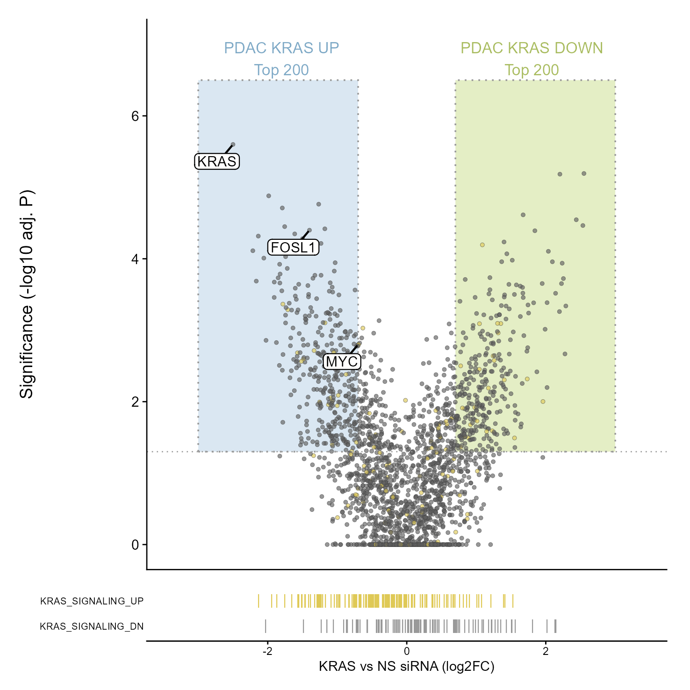
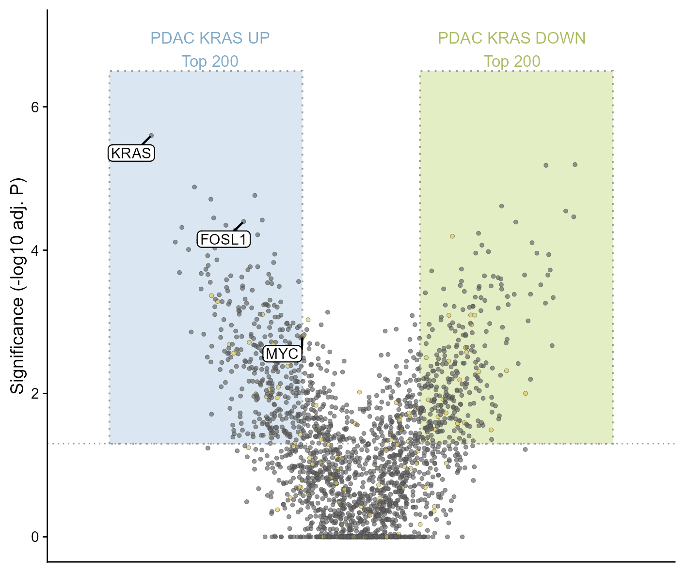
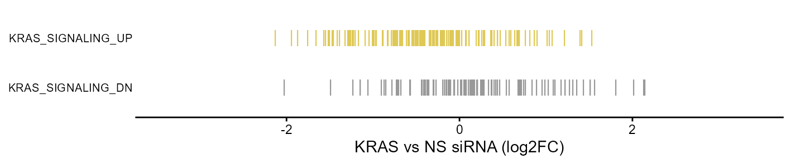

# 火山图与基因集rug条

Volcano plot with gene-set rug tracks

**Volcano plot with gene-set rug tracks**

## 科学问题与应用

差异表达分布与特征基因集成员在FC轴上如何对应？

单个差异比较的火山图、双侧候选区域、基因标签和底部基因集位置。

## 运行

```text
Rscript --vanilla code/organized.R <output-directory>
```

在已经安装依赖的 R 环境中运行；代码不会安装包、访问网络或运行原研究上游流程。输入从本模块定位，不依赖当前工作目录。输出目录通过第一个参数明确传入；不传入时使用 R 会话临时目录。图形维持模板布局与配色；Arial 字体可用时保持该字体。

依赖：dplyr, ggplot2, ggrepel, patchwork, ragg, tidyr。

## 输入与执行范围

合成示例输入；2个运行期输入表。volcano.csv：2200行×5列；signature_rug.csv：240行×2列。每个输入的列名和行数见 data_schema.yml。公开版已实际运行，绘图执行范围为合成数据；不是原论文数值或实验结果。

## 独立图像

本模板对应 3 幅独立 PNG，同时生成配对 PDF；它们不合并成一张替代预览。PDF 为运行输出，不随本公共源码分发。

### 09_volcano_signature.png



### 09a_volcano.png



### 09b_signature_rug.png


