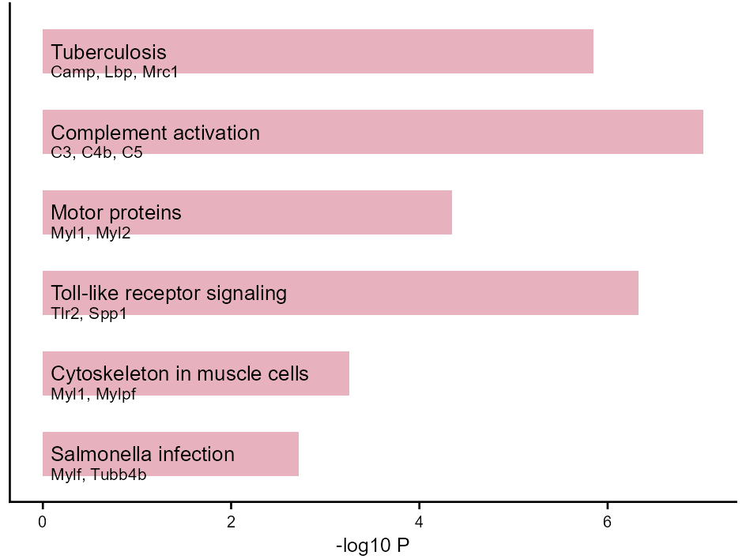
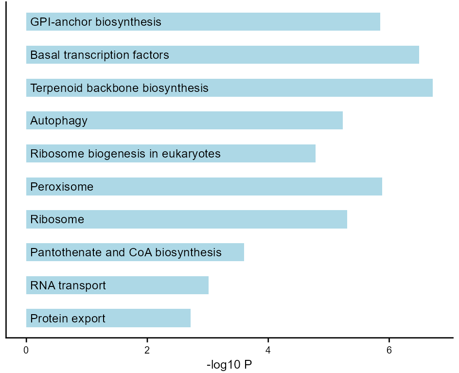
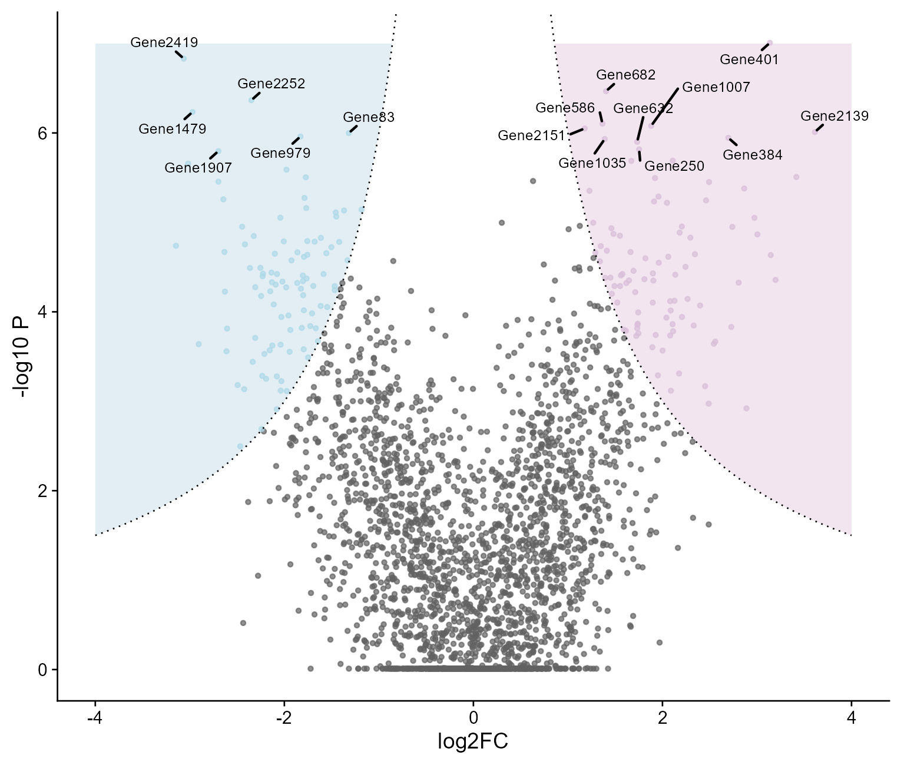
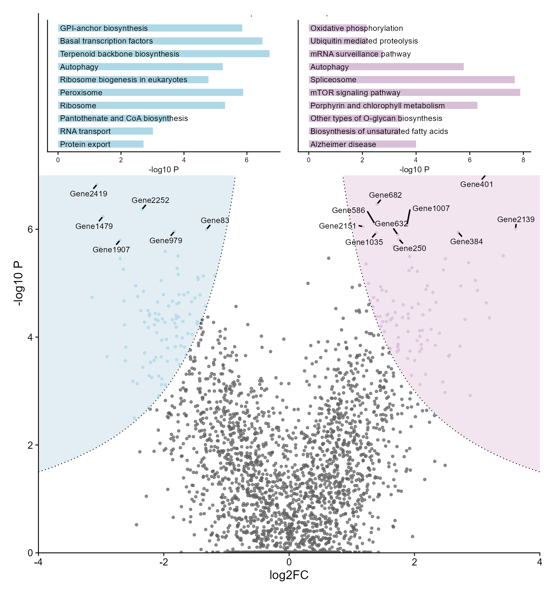
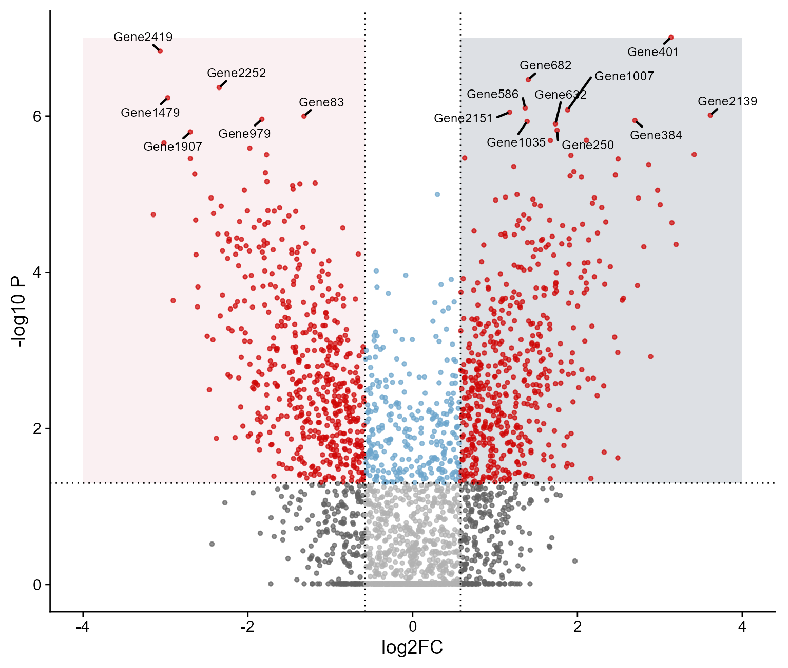
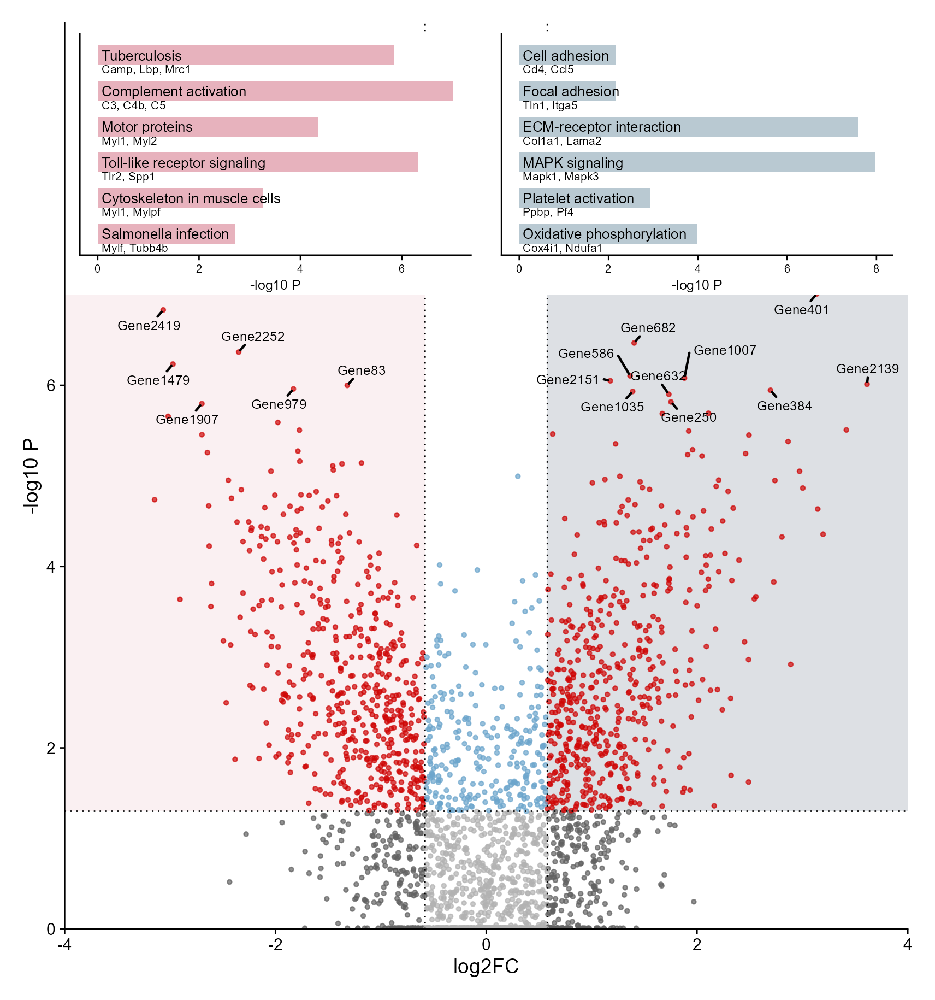
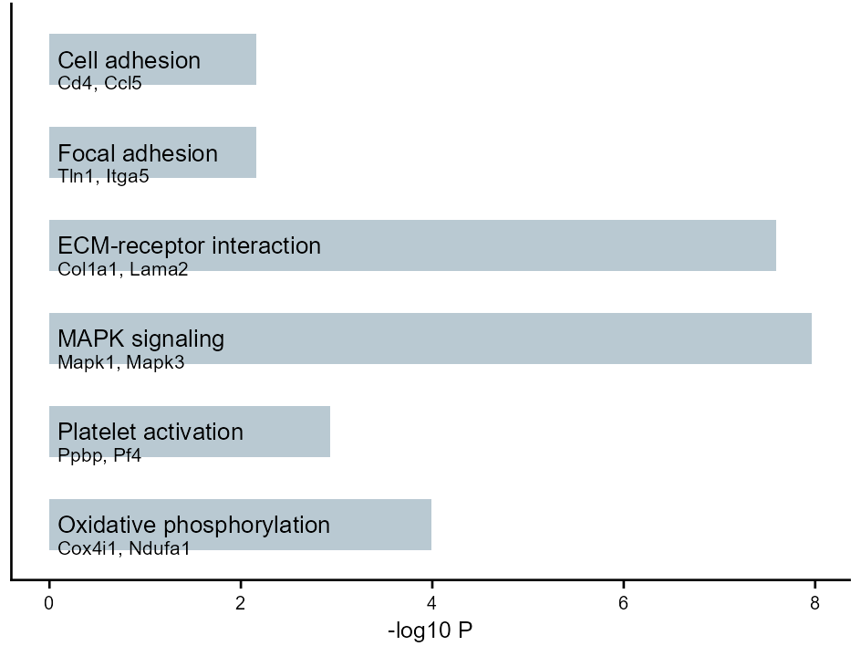
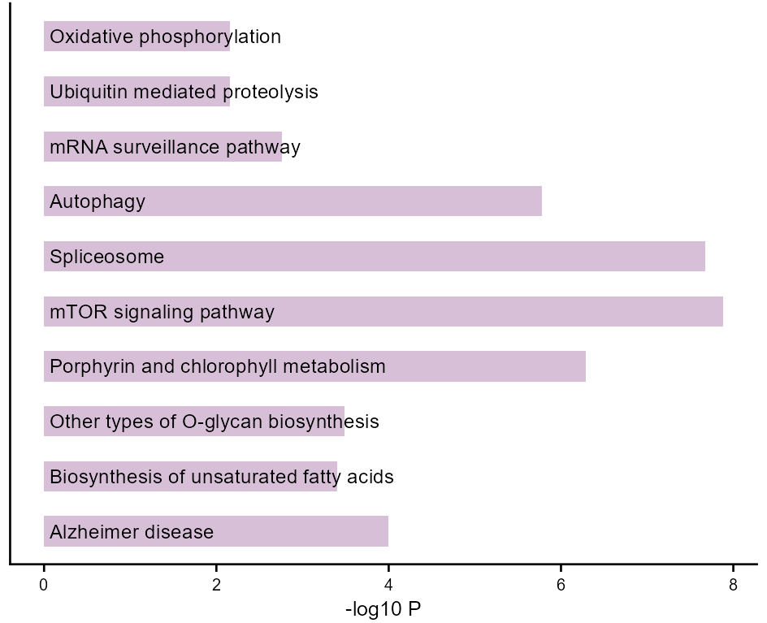

# 火山图与顶端内嵌富集条形图

Volcano plots with top-inset enrichment bars

**Volcano plots with top-inset enrichment bars**

## 科学问题与应用

上下调基因的变化与其功能条目如何在同一画面关联？

线性阈值与双曲线阈值两版，顶端两组富集条形图保持方向对应。

## 运行

```text
Rscript --vanilla code/organized.R <output-directory>
```

在已经安装依赖的 R 环境中运行；代码不会安装包、访问网络或运行原研究上游流程。输入从本模块定位，不依赖当前工作目录。输出目录通过第一个参数明确传入；不传入时使用 R 会话临时目录。图形维持模板布局与配色；Arial 字体可用时保持该字体。

依赖：dplyr, ggplot2, ggrepel, patchwork, ragg, tidyr。

## 输入与执行范围

合成示例输入；2个运行期输入表。volcano.csv：2600行×3列；enrichment.csv：12行×4列。每个输入的列名和行数见 data_schema.yml。公开版已实际运行，绘图执行范围为合成数据；不是原论文数值或实验结果。

## 独立图像

本模板对应 8 幅独立 PNG，同时生成配对 PDF；它们不合并成一张替代预览。PDF 为运行输出，不随本公共源码分发。

### 24_Down_enrichment.png



### 24_Down_kegg_enrichment.png



### 24_hyperbolic_volcano.png



### 24_hyperbolic_volcano_inset_bars.png



### 24_linear_volcano.png



### 24_linear_volcano_inset_bars.png



### 24_Up_enrichment.png



### 24_Up_kegg_enrichment.png


